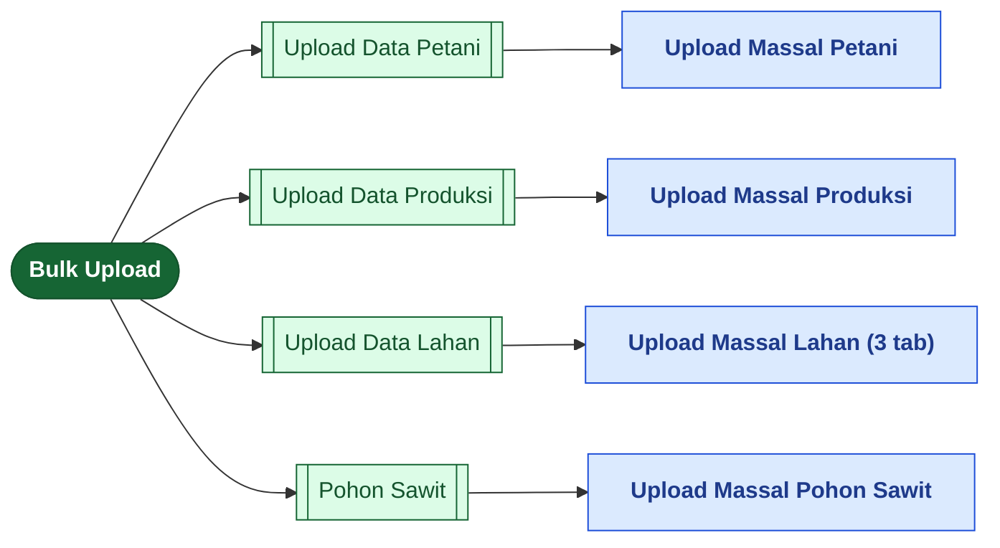
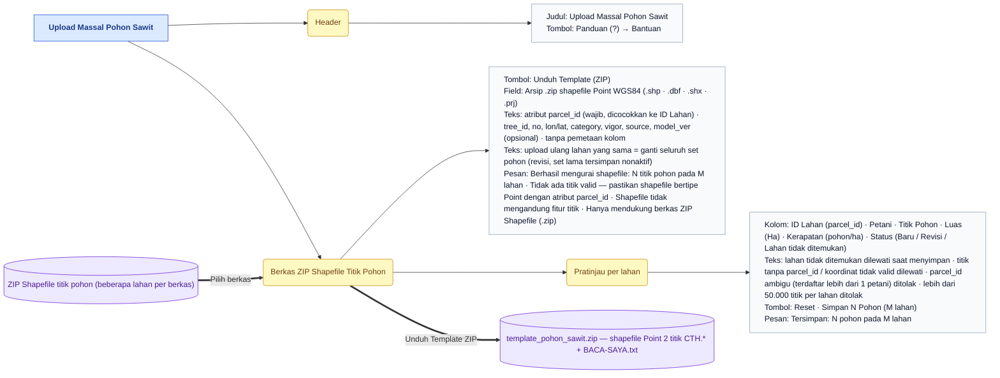
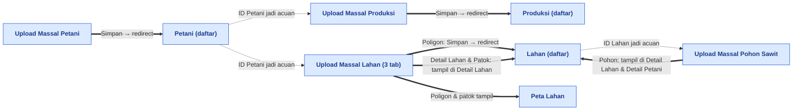

# Peta Fitur — Bulk Upload

> Bagian dari dokumentasi **Produk** · Peta fitur untuk Miro. Indeks: [README.md](README.md) · Legenda: [legend.md](legend.md) · Sumber: [../pages/bulk-upload/README.md](../pages/bulk-upload/README.md)

> **Ringkasan:** Menu unggah massal: memasukkan data petani, produksi, lahan (poligon, detail legalitas, patok batas), dan titik pohon sawit dari berkas Excel/CSV atau ZIP shapefile ke database, lewat wizard bertahap (unduh template → pilih berkas → petakan kolom → validasi & tinjau → simpan). Empat sub menu, empat halaman; halaman Upload Data Lahan punya tiga tab yang masing-masing wizard sendiri. Hasil unggahan muncul di Master Data dan Peta Lahan.

## Pohon navigasi

| Halaman | Route | Katalog |
|---|---|---|
| Upload Massal Petani | `/admin/bulk-upload/farmers` | [farmers.md](../pages/bulk-upload/farmers.md) |
| Upload Massal Produksi | `/admin/bulk-upload/production` | [production.md](../pages/bulk-upload/production.md) |
| Upload Massal Lahan — tab Poligon (Shapefile ZIP) · Detail Lahan (Excel) · Patok (Excel/Shapefile titik) | `/admin/bulk-upload/parcels` | [parcels.md](../pages/bulk-upload/parcels.md) |
| Upload Massal Pohon Sawit | `/admin/bulk-upload/trees` | [trees.md](../pages/bulk-upload/trees.md) |

Halaman induk `/admin/bulk-upload` tidak punya isi; ia mengalihkan ke sub menu pertama yang boleh diakses (bawaan Upload Data Petani). Tidak ada halaman riwayat unggahan — jejak hanya audit `dibuat oleh` pada data hasil simpan. Tiap halaman adalah **satu halaman wizard**: kartu langkah muncul berurutan di halaman yang sama, bukan route terpisah.

## Upload Massal Petani

```mermaid
%%{init: {"flowchart": {"wrappingWidth": 420}}}%%
flowchart LR
  bu_farmers["Upload Massal Petani"]:::page

  bu_farmers_hdr("Header"):::section
  bu_farmers_hdr_c["Judul: Upload Massal Petani<br/>Teks: Unggah data petani menggunakan file Excel (.xlsx) atau CSV dengan pencocokan kolom dinamis<br/>Tombol: Panduan (?) → Bantuan"]:::content

  bu_farmers_s1("1. Pilih Lembaga Petani"):::section
  bu_farmers_s1_c["Field: Lembaga Petani (combobox — cari nama atau kode, item Nama (KODE))<br/>Teks: Pilih Lembaga Petani tujuan terlebih dahulu sebelum mengunggah data<br/>Pesan: Lembaga Petani tidak ditemukan<br/>Teks: ganti lembaga = reset berkas, pemetaan, dan hasil validasi"]:::content

  bu_farmers_s2("2. Pilih File Data Petani"):::section
  bu_farmers_s2_c["Tombol: Unduh Template Excel (aktif walau lembaga belum dipilih)<br/>Field: Berkas .xlsx / .csv — nonaktif sampai lembaga dipilih<br/>Teks: Tipe file terdeteksi: XLSX/CSV (N baris data)<br/>Pesan: Harap pilih Lembaga Petani di atas terlebih dahulu · Hanya mendukung berkas Excel (.xlsx) atau CSV<br/>Pesan: Header ditemukan di baris X · Tidak menemukan baris header pada berkas ini"]:::content

  bu_farmers_map("Petakan Kolom Data"):::section
  bu_farmers_map_c["Field: ID Petani* · Nama Petani* · Jenis Kelamin* · NIK · Tempat Lahir · Tanggal Lahir · Alamat · Tahun Bergabung<br/>Teks: tiap baris = label · pilihan kolom (-- Kosongkan --) · contoh nilai baris pertama · ringkasan n/8 field terpetakan<br/>Teks: auto-match tajuk berkas · ubah pemetaan mengosongkan hasil validasi<br/>Tombol: Validasi Data<br/>Pesan: Kolom wajib berikut belum dipetakan: … · Validasi selesai"]:::content

  bu_farmers_val("Hasil Validasi & Tinjauan"):::section
  bu_farmers_val_c["KPI: N Baris Valid · N Baris Tidak Lengkap · N Baris Error<br/>Filter: Semua (N) · Valid (N) · Tidak Lengkap (N) · Error (N)<br/>Tombol: Download Semua Data · Download Data Tidak Lengkap · Download Data Error Saja<br/>Kolom: Baris · ID Petani · Nama · L/P · NIK · Lembaga Petani · Tahun Bergabung · Tanggal Lahir · Status · Keterangan / Detail Error<br/>Pesan: ID Petani duplikat di dalam file · ID Petani sudah terdaftar di database · NIK harus 16 digit angka · Jenis kelamin tidak valid (L/P) · Format Tanggal Lahir tidak valid · Tahun bergabung tidak valid (1900-2100)<br/>Teks: Tidak Lengkap = lolos tetapi NIK / Tempat-Tanggal Lahir / Alamat / Tahun Bergabung kosong<br/>Teks: Menampilkan 100 baris pertama dari total N baris data · Tidak ada data untuk filter ini"]:::content

  bu_farmers_save("Simpan"):::section
  bu_farmers_save_c["Tombol: Simpan Semua Layak (N) — valid + tidak lengkap<br/>Tombol: Simpan Hanya yang Valid (N) — tampil bila ada baris tidak lengkap<br/>Teks: label menjadi Simpan N Data Valid bila tidak ada baris tidak lengkap · unggah hanya menambah, tidak memperbarui<br/>Pesan: Berhasil menyimpan N data petani · Ada ID Petani yang sudah terdaftar di lembaga ini — jalankan Validasi Data sekali lagi"]:::content

  bu_farmers_tpl[("template_upload_petani.xlsx — sheet Data (8 tajuk + 2 contoh CTH.*) + Petunjuk")]:::data
  bu_farmers_file[("Berkas Excel / CSV data petani")]:::data
  bu_farmers_dl[("bulk_upload_petani_full / _tidak_lengkap / _error_only.xlsx (12 kolom)")]:::data
  md_farmers_list["Petani (daftar)"]:::page

  bu_farmers --> bu_farmers_hdr --> bu_farmers_hdr_c
  bu_farmers --> bu_farmers_s1 --> bu_farmers_s1_c
  bu_farmers_s1 --> bu_farmers_s2 --> bu_farmers_s2_c
  bu_farmers_s2 --> bu_farmers_map --> bu_farmers_map_c
  bu_farmers_map --> bu_farmers_val --> bu_farmers_val_c
  bu_farmers_val --> bu_farmers_save --> bu_farmers_save_c
  bu_farmers_s2 ==>|Unduh Template Excel| bu_farmers_tpl
  bu_farmers_file ==>|Pilih berkas| bu_farmers_s2
  bu_farmers_val ==>|Download| bu_farmers_dl
  bu_farmers_save -.->|Berhasil → redirect| md_farmers_list

  classDef page fill:#dbeafe,stroke:#1d4ed8,color:#1e3a8a,font-weight:bold
  classDef section fill:#fef9c3,stroke:#ca8a04,color:#713f12
  classDef content fill:#f8fafc,stroke:#94a3b8,color:#0f172a,text-align:left
  classDef data fill:#ede9fe,stroke:#6d28d9,color:#4c1d95
```

Satu unggahan = satu Lembaga Petani tujuan. Baris berstatus **Tidak Lengkap** boleh disimpan (Simpan Semua Layak) atau ditahan (Simpan Hanya yang Valid) agar dilengkapi di berkas lalu diunggah ulang. ID contoh template `CTH.*` ditolak saat validasi dan saat simpan.

## Upload Massal Produksi

```mermaid
%%{init: {"flowchart": {"wrappingWidth": 420}}}%%
flowchart LR
  bu_production["Upload Massal Produksi"]:::page

  bu_production_hdr("Header"):::section
  bu_production_hdr_c["Judul: Upload Massal Produksi<br/>Teks: Unggah data produksi petani menggunakan file Excel (.xlsx) atau CSV dengan pencocokan kolom dinamis<br/>Tombol: Panduan (?) → Bantuan"]:::content

  bu_production_s1("1. Pilih File Data Produksi"):::section
  bu_production_s1_c["Tombol: Unduh Template Excel<br/>Field: Berkas .xlsx / .csv — data transaksi panen / produksi petani<br/>Teks: Tipe File: XLSX/CSV (N baris terdeteksi)<br/>Pesan: Hanya mendukung berkas Excel (.xlsx) atau CSV · Header ditemukan di baris X · Tidak menemukan baris header pada berkas ini"]:::content

  bu_production_map("2. Petakan Atribut Kolom"):::section
  bu_production_map_c["Field: ID Petani* · Periode* (YYYY-MM) · Tanggal Panen* · Panen Ke-* (1–4) · Hasil Panen (kg)* · ID Lahan · Catatan<br/>Teks: tiap baris = label · pilihan kolom · contoh nilai baris pertama · ringkasan n/7 terpetakan<br/>Tombol: Validasi Data Produksi<br/>Pesan: Kolom wajib berikut belum dipetakan: … · Validasi selesai"]:::content

  bu_production_val("3. Hasil Validasi & Tinjauan"):::section
  bu_production_val_c["KPI: N Baris Valid · N Baris Error<br/>Filter: Semua (N) · Valid (N) · Error (N)<br/>Tombol: Download Semua Data · Download Data Error Saja<br/>Kolom: No · ID Petani (Asal) · Nama Petani (DB) · Periode · Tanggal Panen · Panen Ke- · Hasil (kg) · ID Lahan · Status · Detail Error<br/>Pesan: ID Petani tidak ditemukan dalam database atau akses Anda · Format periode tidak valid (YYYY-MM) · Tanggal panen tidak sesuai dengan periode · Panen Ke- tidak valid (1 s/d 4) · Hasil panen tidak valid (harus angka lebih dari 0) · Data panen ganda di dalam file · Data panen sudah terdaftar di database<br/>Teks: Menampilkan 100 baris pertama dari total N baris data"]:::content

  bu_production_save("Simpan"):::section
  bu_production_save_c["Tombol: Simpan N Data Valid<br/>Pesan: Berhasil menyimpan N data produksi<br/>Pesan: ID Lahan tidak ditemukan atau tidak aktif · ID Lahan tidak dimiliki oleh petani terpilih · Tidak memiliki izin untuk membuat data produksi bagi petani dengan ID …"]:::content

  bu_production_tpl[("template_upload_produksi.xlsx — sheet Data (7 tajuk + 2 contoh CTH.*) + Petunjuk")]:::data
  bu_production_file[("Berkas Excel / CSV data produksi")]:::data
  bu_production_dl[("bulk_upload_produksi_full / _error_only.xlsx (11 kolom)")]:::data
  md_production_list["Produksi (daftar)"]:::page

  bu_production --> bu_production_hdr --> bu_production_hdr_c
  bu_production --> bu_production_s1 --> bu_production_s1_c
  bu_production_s1 --> bu_production_map --> bu_production_map_c
  bu_production_map --> bu_production_val --> bu_production_val_c
  bu_production_val --> bu_production_save --> bu_production_save_c
  bu_production_s1 ==>|Unduh Template Excel| bu_production_tpl
  bu_production_file ==>|Pilih berkas| bu_production_s1
  bu_production_val ==>|Download| bu_production_dl
  bu_production_save -.->|Berhasil → redirect| md_production_list

  classDef page fill:#dbeafe,stroke:#1d4ed8,color:#1e3a8a,font-weight:bold
  classDef section fill:#fef9c3,stroke:#ca8a04,color:#713f12
  classDef content fill:#f8fafc,stroke:#94a3b8,color:#0f172a,text-align:left
  classDef data fill:#ede9fe,stroke:#6d28d9,color:#4c1d95
```

Tidak ada pemilihan Lembaga: petani dikenali dari `ID Petani` terhadap data referensi dalam cakupan akses pengguna. `ID Lahan` opsional, tetapi bila diisi harus milik petani yang sama.

## Upload Massal Lahan — bagian 1/3: tab Poligon (Shapefile ZIP)

```mermaid
%%{init: {"flowchart": {"wrappingWidth": 420}}}%%
flowchart LR
  bu_parcels["Upload Massal Lahan (3 tab)"]:::page

  bu_parcels_hdr("Header"):::section
  bu_parcels_hdr_c["Judul: Upload Massal Lahan<br/>Teks: Poligon lahan dari ZIP Shapefile · detail lahan (surat, STDB, UL Parcel Code, sepadan, NKT) dari Excel · titik patok batas untuk lahan yang sudah terdaftar<br/>Tab: Poligon (Shapefile ZIP) — bawaan · Detail Lahan (Excel) · Patok (Excel/Shapefile titik)<br/>Tombol: Panduan (?) → Bantuan"]:::content

  bu_parcels_shp_tab("Tab: Poligon (Shapefile ZIP)"):::section

  bu_parcels_shp_s1("1. Pilih ZIP Shapefile"):::section
  bu_parcels_shp_s1_c["Tombol: Unduh Template (ZIP)<br/>Field: Arsip .zip berisi .shp · .dbf · .shx · .prj<br/>Teks: Shapefile: nama.zip (N fitur/baris terdeteksi)<br/>Pesan: Berhasil mengurai shapefile: N geometri lahan terdeteksi · Shapefile tidak mengandung data geometri/fitur · Gagal mengurai file shapefile · Gagal membaca berkas ZIP · Hanya mendukung berkas ZIP Shapefile (.zip)"]:::content

  bu_parcels_shp_map("2. Petakan Atribut Kolom (4 grup)"):::section
  bu_parcels_shp_map_c["Field (Identitas): ID Lahan* · ID Petani*<br/>Field (Atribut lahan): Luas (ha) · Status Kepemilikan · Komoditas (kosong = Kelapa Sawit) · Tahun Tanam · Revisi · Catatan<br/>Field (Kelompok & Blok): Kelompok Tani · Blok<br/>Field (Sepadan): Utara · Timur · Selatan · Barat<br/>Teks: grup buka/tutup ber-n/m · contoh nilai fitur pertama · grup tanpa atribut terdeteksi tertutup<br/>Tombol: Validasi Data Shapefile<br/>Pesan: Validasi selesai"]:::content

  bu_parcels_shp_val("3. Hasil Validasi & Tinjauan"):::section
  bu_parcels_shp_val_c["KPI: N Lahan Valid · N Lahan Error · Tumpang Tindih (N)<br/>Filter: Semua (N) · Valid (N) · Tumpang Tindih (N) · Error (N)<br/>Tombol: Download Semua Data · Download Data Error Saja<br/>Kolom: No · ID Lahan · ID Petani (Asal) · Nama Petani (DB) · Luas (ha) · Status Kepemilikan · Komoditas · Tahun Tanam<br/>Kolom: Kelompok Tani · Blok · Revisi · Status · Keterangan<br/>Pesan: ID Petani tidak terdaftar di database · ID Lahan duplikat di dalam file · ID Lahan sudah terdaftar dengan polygon yang sama · Luas lahan tidak valid · Geometri tidak valid (Polygon / MultiPolygon)<br/>Teks: ID sama + geometri berbeda = revisi baru (bukan error) · tumpang tindih = peringatan kuning, tidak memblokir simpan"]:::content

  bu_parcels_shp_mapview("Peta preview"):::section
  bu_parcels_shp_mapview_c["Layer: poligon hijau = valid · kuning = valid tetapi tumpang tindih · merah = error (ikut filter aktif)<br/>Tombol: Fokus Semua · basemap STREET · LIGHT · DARK · SAT · HYBRID (bawaan)<br/>Teks: popup Detail Lahan — badge Valid/Error · ID · Petani · Error Detail"]:::content

  bu_parcels_shp_save("Simpan"):::section
  bu_parcels_shp_save_c["Tombol: Simpan N Lahan Valid<br/>Pesan: Berhasil menyimpan N data lahan<br/>Teks: revisi = baris lama dinonaktifkan, baris baru revision + 1 · produksi dan pohon lahan itu ikut dipindah · sepadan terisi menimpa, kosong dibiarkan"]:::content

  bu_parcels_shp_tpl[("template_poligon_lahan.zip — shp/shx/dbf/prj/cpg (1 poligon CTH.*) + BACA-SAYA.txt")]:::data
  bu_parcels_shp_file[("ZIP Shapefile poligon lahan (atribut DBF)")]:::data
  bu_parcels_shp_dl[("bulk_upload_lahan_full / _error_only.xlsx (19 kolom)")]:::data
  md_parcels_list["Lahan (daftar)"]:::page

  bu_parcels --> bu_parcels_hdr --> bu_parcels_hdr_c
  bu_parcels --> bu_parcels_shp_tab --> bu_parcels_shp_s1 --> bu_parcels_shp_s1_c
  bu_parcels_shp_s1 --> bu_parcels_shp_map --> bu_parcels_shp_map_c
  bu_parcels_shp_map --> bu_parcels_shp_val --> bu_parcels_shp_val_c
  bu_parcels_shp_val --> bu_parcels_shp_mapview --> bu_parcels_shp_mapview_c
  bu_parcels_shp_val --> bu_parcels_shp_save --> bu_parcels_shp_save_c
  bu_parcels_shp_s1 ==>|Unduh Template ZIP| bu_parcels_shp_tpl
  bu_parcels_shp_file ==>|Pilih berkas| bu_parcels_shp_s1
  bu_parcels_shp_val ==>|Download| bu_parcels_shp_dl
  bu_parcels_shp_save -.->|Berhasil → redirect| md_parcels_list

  classDef page fill:#dbeafe,stroke:#1d4ed8,color:#1e3a8a,font-weight:bold
  classDef section fill:#fef9c3,stroke:#ca8a04,color:#713f12
  classDef content fill:#f8fafc,stroke:#94a3b8,color:#0f172a,text-align:left
  classDef data fill:#ede9fe,stroke:#6d28d9,color:#4c1d95
```

Unggah ulang poligon = **survei baru**: baris lahan lama dinonaktifkan dan baris baru dibuat dengan nomor revisi naik; data produksi dan titik pohon ikut berpindah ke baris baru.

## Upload Massal Lahan — bagian 2/3: tab Detail Lahan (Excel)

```mermaid
%%{init: {"flowchart": {"wrappingWidth": 420}}}%%
flowchart LR
  bu_parcels["Upload Massal Lahan (3 tab)"]:::page

  bu_parcels_det_tab("Tab: Detail Lahan (Excel)"):::section

  bu_parcels_det_s1("1. Pilih File Detail Lahan"):::section
  bu_parcels_det_s1_c["Tombol: Unduh Template Excel · Template NKT<br/>Field: Berkas .xlsx / .csv<br/>Teks: N lahan terdaftar dalam cakupan (dimuat saat tab dibuka) · sheet tersembunyi dilewati, sheet Data dibaca lebih dulu<br/>Pesan: Hanya mendukung berkas Excel (.xlsx) atau CSV · Header ditemukan di baris X · Tidak menemukan baris header pada berkas ini · Gagal memuat daftar lahan untuk pencocokan"]:::content

  bu_parcels_det_map("2. Petakan Atribut Kolom (5 grup)"):::section
  bu_parcels_det_map_c["Field (Identitas): ID Lahan* · ID Petani*<br/>Field (Legalitas): Jenis Surat Tanah · Nomor Surat · Nama tertera di Surat · Luas tertera di Surat (ha) · Nomor STDB · UL Parcel Code (parcel_code)<br/>Field (Kelompok & Blok): Nama Kelompok Tani · Blok — isi hanya bila kosong<br/>Field (Sepadan): Utara · Timur · Selatan · Barat<br/>Field (NKT): Status NKT · Kategori NKT · Luas NKT Area (ha) · Panjang NKT (m) · Tanggal Asesmen NKT · Asesor / Sumber NKT<br/>Field (Bawaan NKT untuk berkas ini): Status untuk semua baris · Kategori bawaan (NKT 1–6) · Tanggal asesmen bawaan · Asesor / sumber bawaan<br/>Tombol: Validasi Detail Lahan<br/>Pesan: Kolom wajib belum dipetakan · Daftar lahan masih dimuat, coba lagi sebentar · Validasi selesai"]:::content

  bu_parcels_det_val("3. Hasil Validasi & Tinjauan"):::section
  bu_parcels_det_val_c["KPI: N Baris Valid · N Baris Error<br/>Filter: Semua (N) · Valid (N) · Error (N)<br/>Tombol: Download Semua Data · Download Data Error Saja<br/>Kolom: No · ID Lahan · ID Petani · Nama Petani (DB) · Jenis Surat · Nomor Surat · Nama di Surat · Luas Surat (ha)<br/>Kolom: STDB · UL Parcel Code · Kelompok Tani (sudah ada) · Blok · Sepadan (U · T · S · B) · NKT · Status · Detail Error<br/>Pesan: ID Lahan tidak terdaftar untuk petani · ID Lahan muncul di file dengan ID Petani berbeda · Nomor STDB dipakai ID Petani berbeda · Luas tertera terlalu besar (maks 25 ha, kemungkinan m²) · Status NKT wajib · Kategori NKT wajib untuk lahan termasuk/terdampak · Tidak ada data detail untuk disimpan<br/>Pesan: peringatan — berkas tanpa kolom UL Parcel Code: lahan tetap tersimpan tetapi tidak terhitung sudah didata di Laporan Lahan<br/>Teks: 100 baris pertama · nomor Baris = baris fisik berkas"]:::content

  bu_parcels_det_save("Simpan"):::section
  bu_parcels_det_save_c["Field: Pemeta (sumber UL Parcel Code) — Meridia (bawaan) · WRI · Swadaya · Lainnya…<br/>Tombol: Simpan N Baris Valid<br/>Pesan: N baris tersimpan — surat baru / diperbarui / tanpa perubahan · STDB baru + tautan (belum bernomor dihitung) · UL Parcel Code baru / diperbarui / juga dipakai lahan lain · kelompok tani terisi · sepadan · blok terisi · NKT<br/>Pesan: Isi nama pemeta terlebih dahulu<br/>Teks: upsert — unggah ulang aman · 500 baris per transaksi · tetap di halaman (tanpa redirect)"]:::content

  bu_parcels_det_tpl[("template_detail_lahan.xlsx · template_nkt_lahan.xlsx (11 tajuk)")]:::data
  bu_parcels_det_file[("Berkas Excel / CSV detail lahan (MIS_KAB_data-lahan.xlsx)")]:::data
  bu_parcels_det_dl[("detail_lahan_semua / detail_lahan_error.xlsx")]:::data

  bu_parcels --> bu_parcels_det_tab --> bu_parcels_det_s1 --> bu_parcels_det_s1_c
  bu_parcels_det_s1 --> bu_parcels_det_map --> bu_parcels_det_map_c
  bu_parcels_det_map --> bu_parcels_det_val --> bu_parcels_det_val_c
  bu_parcels_det_val --> bu_parcels_det_save --> bu_parcels_det_save_c
  bu_parcels_det_s1 ==>|Unduh Template Excel / Template NKT| bu_parcels_det_tpl
  bu_parcels_det_file ==>|Pilih berkas| bu_parcels_det_s1
  bu_parcels_det_val ==>|Download| bu_parcels_det_dl

  classDef page fill:#dbeafe,stroke:#1d4ed8,color:#1e3a8a,font-weight:bold
  classDef section fill:#fef9c3,stroke:#ca8a04,color:#713f12
  classDef content fill:#f8fafc,stroke:#94a3b8,color:#0f172a,text-align:left
  classDef data fill:#ede9fe,stroke:#6d28d9,color:#4c1d95
```

Tab ini **tidak membuat lahan baru**: ia mengisi satelit lahan yang sudah terdaftar dan aktif — surat kepemilikan, STDB, UL Parcel Code, sepadan, NKT, serta Kelompok Tani/Blok yang masih kosong — dan menempel ke identitas lahan yang stabil antar revisi. Nilai Status NKT di sel selalu menang atas **Bawaan NKT** berkas; bawaan dipakai untuk daftar lahan terdampak yang hanya memuat ID + luas.

## Upload Massal Lahan — bagian 3/3: tab Patok (Excel/Shapefile titik)

```mermaid
%%{init: {"flowchart": {"wrappingWidth": 420}}}%%
flowchart LR
  bu_parcels["Upload Massal Lahan (3 tab)"]:::page

  bu_parcels_mk_tab("Tab: Patok (Excel/Shapefile titik)"):::section

  bu_parcels_mk_s1("Berkas titik patok"):::section
  bu_parcels_mk_s1_c["Tombol: Unduh Template Excel<br/>Field: Berkas Excel (.xlsx), CSV, atau ZIP Shapefile Point<br/>Teks: kolom ID Lahan (wajib) · Lintang · Bujur (wajib — dari geometri bila shapefile) · No Patok · ID Petani (bila ID Lahan dipakai lebih dari 1 petani) · Kondisi · Bahan · Tanggal Pemasangan · Dipasang oleh · Keterangan<br/>Pesan: N titik terbaca dari shapefile · Shapefile tidak mengandung fitur titik · N fitur dilewati · Maksimal N baris per berkas · Header ditemukan di baris X · Tidak menemukan baris header pada berkas ini"]:::content

  bu_parcels_mk_map("Pemetaan kolom — nama berkas (N baris) · 3 grup"):::section
  bu_parcels_mk_map_c["Field (Lahan & koordinat): ID Lahan* · ID Petani · Lintang* · Bujur*<br/>Field (Nomor patok): Kode Patok (mis. HJP-PTK-000123 → patok itu diperbarui) · No Patok<br/>Field (Kondisi & pemasangan): Kondisi · Bahan · Tanggal Pemasangan · Dipasang oleh · Keterangan<br/>Tombol: Reset · Validasi<br/>Pesan: Kolom wajib belum dipetakan · N baris valid, M bermasalah · Tidak ada baris valid — periksa kolom error"]:::content

  bu_parcels_mk_prev("Pratinjau — N valid pada M lahan"):::section
  bu_parcels_mk_prev_c["Kolom: Baris · ID Lahan · Petani · No · Koordinat · Kondisi · Bahan · Status<br/>Teks: baris bermasalah dilewati · lat/long tertukar ditandai · nomor ganda dalam berkas ditolak · lahan tanpa poligon ditolak<br/>Teks: nomor yang sudah ada = koordinat diperbarui · nomor baru/kosong = patok baru, snap ≤ 5 m ke patok lahan tetangga · lebih dari 100 m dari batas ditolak per baris<br/>Tombol: Simpan N patok<br/>Pesan: Patok tersimpan: N baru · M diperbarui · K ditautkan"]:::content

  bu_parcels_mk_tpl[("Template_Patok_Lahan.xlsx")]:::data
  bu_parcels_mk_file[("Berkas Excel / CSV GPS atau ZIP Shapefile Point patok")]:::data

  bu_parcels --> bu_parcels_mk_tab --> bu_parcels_mk_s1 --> bu_parcels_mk_s1_c
  bu_parcels_mk_s1 --> bu_parcels_mk_map --> bu_parcels_mk_map_c
  bu_parcels_mk_map --> bu_parcels_mk_prev --> bu_parcels_mk_prev_c
  bu_parcels_mk_s1 ==>|Unduh Template Excel| bu_parcels_mk_tpl
  bu_parcels_mk_file ==>|Pilih berkas| bu_parcels_mk_s1

  classDef page fill:#dbeafe,stroke:#1d4ed8,color:#1e3a8a,font-weight:bold
  classDef section fill:#fef9c3,stroke:#ca8a04,color:#713f12
  classDef content fill:#f8fafc,stroke:#94a3b8,color:#0f172a,text-align:left
  classDef data fill:#ede9fe,stroke:#6d28d9,color:#4c1d95
```

Tab Patok tidak punya tombol unduh hasil validasi; baris bermasalah terlihat di pratinjau (latar merah) dan **dilewati** saat simpan. Simpan berjalan satu transaksi per lahan — galat satu lahan tidak membatalkan lahan lain — dan pengguna tetap di halaman.

## Upload Massal Pohon Sawit

Halaman paling ringkas: dua langkah tanpa pemetaan kolom (atribut DBF baku) dan tanpa unduhan hasil. Titik dikelompokkan otomatis per `parcel_id`, satu ZIP boleh memuat banyak lahan. Hasilnya terlihat di Detail Lahan (kartu Pohon Sawit, titik kuning di peta) dan Detail Petani tab Lahan.

## Alur lintas menu

Urutan ketergantungan data: **Petani** dahulu (dipilih per Lembaga Petani dari Master Data), lalu **Produksi** dan **Poligon lahan** yang merujuk `ID Petani`, lalu **Detail Lahan**, **Patok**, dan **Pohon Sawit** yang merujuk lahan yang sudah terdaftar. Tidak ada berkas unggahan yang disimpan ke penyimpanan berkas (S3): Excel/CSV diurai di browser, shapefile diurai di server lalu dibuang — hanya hasil validnya yang masuk database. Tombol Panduan (?) di tiap header membuka tutorial Bantuan halaman itu.

## Urutan demo yang disarankan

1. Buka Bulk Upload → Upload Data Petani: pilih Lembaga Petani, klik Unduh Template Excel, tunjukkan sheet Data + Petunjuk dan baris contoh `CTH.*`.
2. Pilih berkas petani, tunjukkan pemetaan kolom otomatis dan ringkasan n/8 terpetakan, klik Validasi Data.
3. Tinjau tiga status (Valid / Tidak Lengkap / Error), unduh Download Data Error Saja, lalu Simpan Semua Layak → mendarat di Daftar Petani.
4. Upload Data Produksi: alur 3 langkah yang sama; tunjukkan error tanggal panen di luar periode dan duplikat di database, lalu Simpan N Data Valid → Daftar Produksi.
5. Upload Data Lahan tab Poligon: unggah ZIP shapefile, pemetaan berkelompok (4 grup), validasi, peta preview hijau/kuning/merah + Fokus Semua, Simpan N Lahan Valid → Daftar Lahan; tunjukkan revisi saat ZIP yang sama diunggah ulang dengan geometri berbeda.
6. Tab Detail Lahan: Excel detail legalitas (surat, STDB, UL Parcel Code), panel Bawaan NKT, pilih Pemeta, Simpan N Baris Valid; buka Detail Lahan untuk melihat hasilnya.
7. Tab Patok: unggah Excel GPS atau shapefile Point, pratinjau per baris, Simpan N patok; buka Peta Lahan untuk melihat patok.
8. Pohon Sawit: unggah ZIP titik, pratinjau per lahan dengan kerapatan, Simpan N Pohon; buka Detail Lahan untuk kartu Pohon Sawit dan titik kuning di peta.
