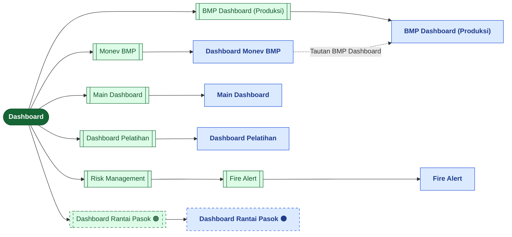
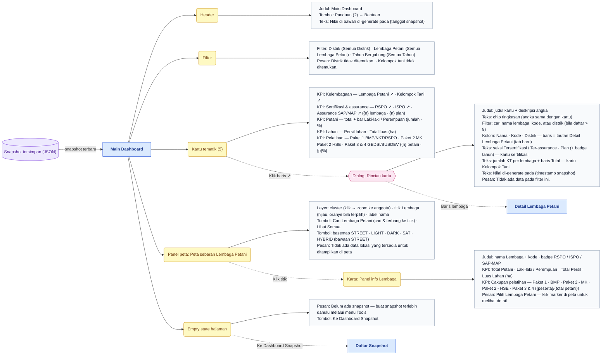
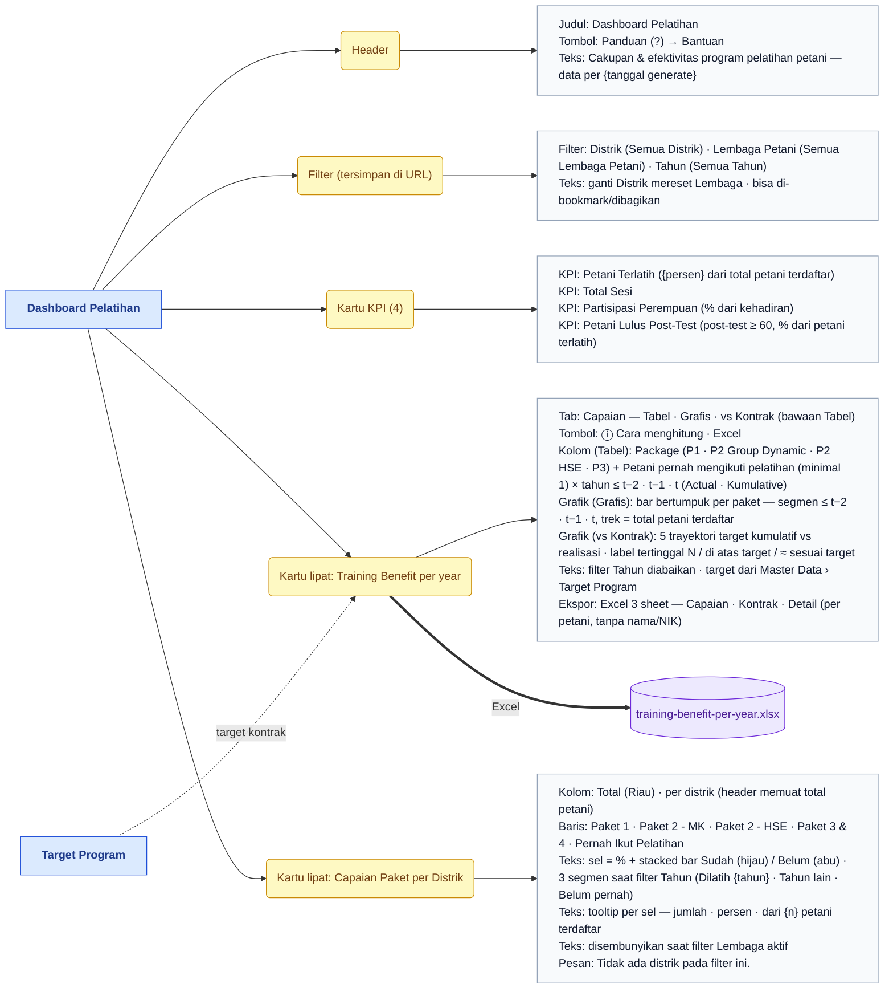
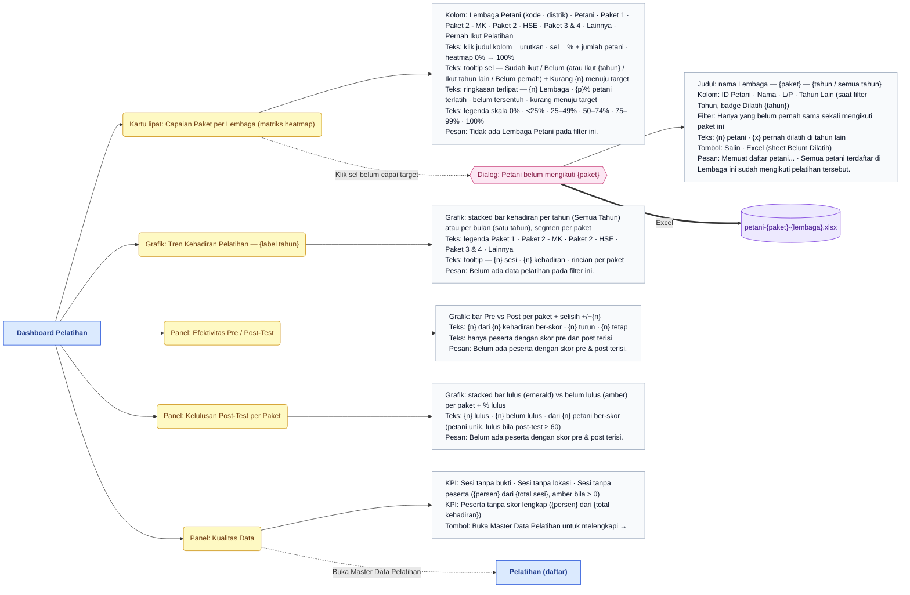
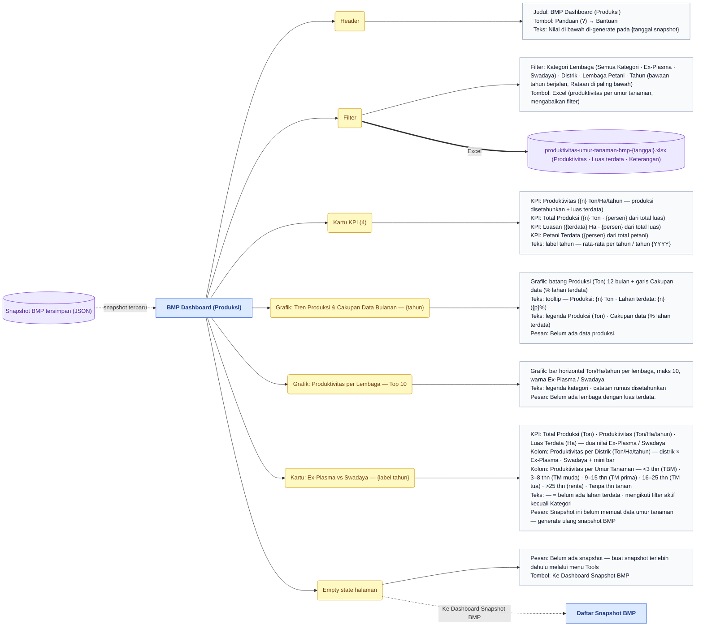
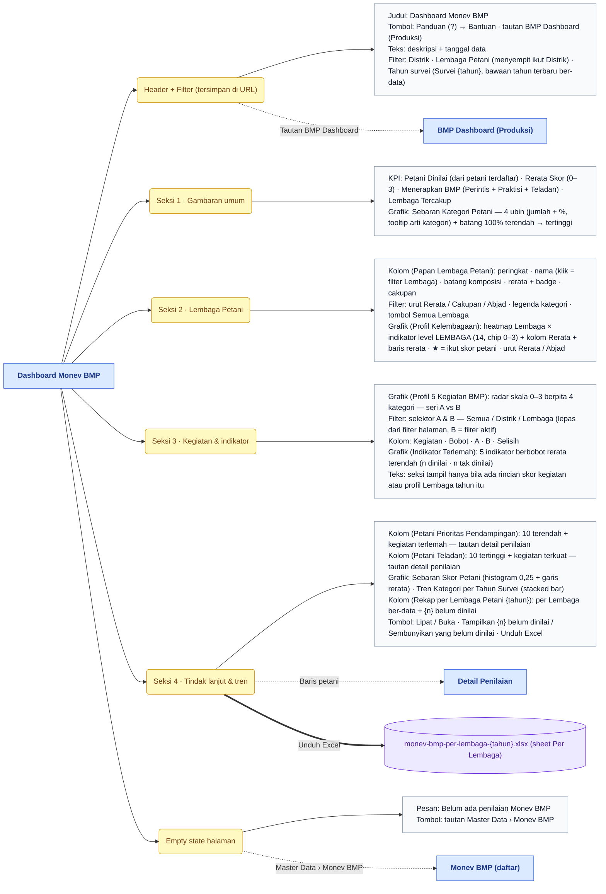
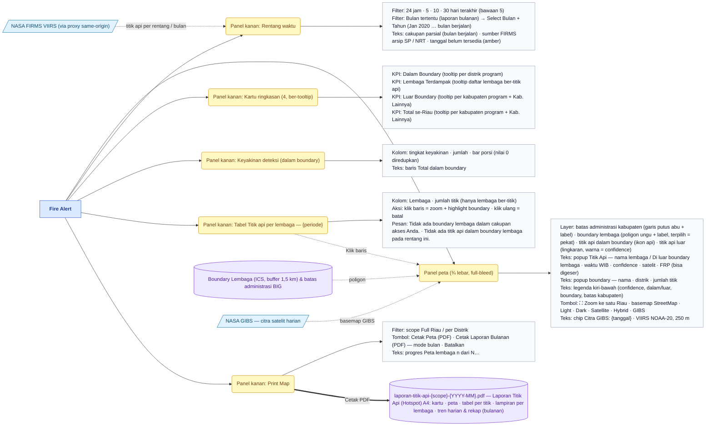
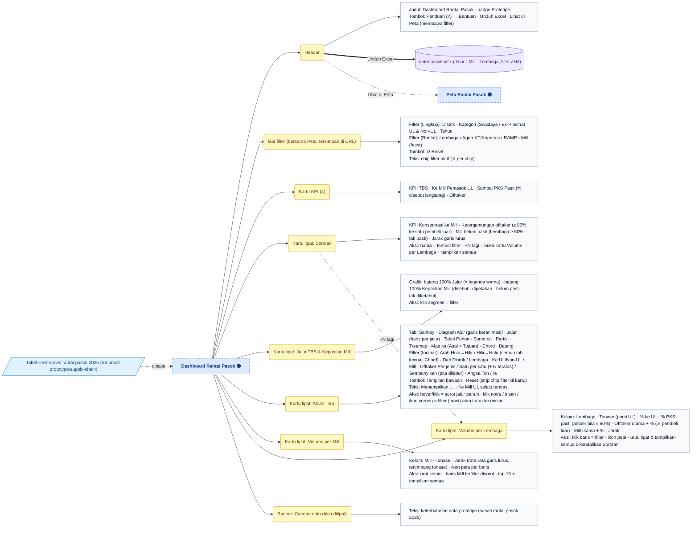
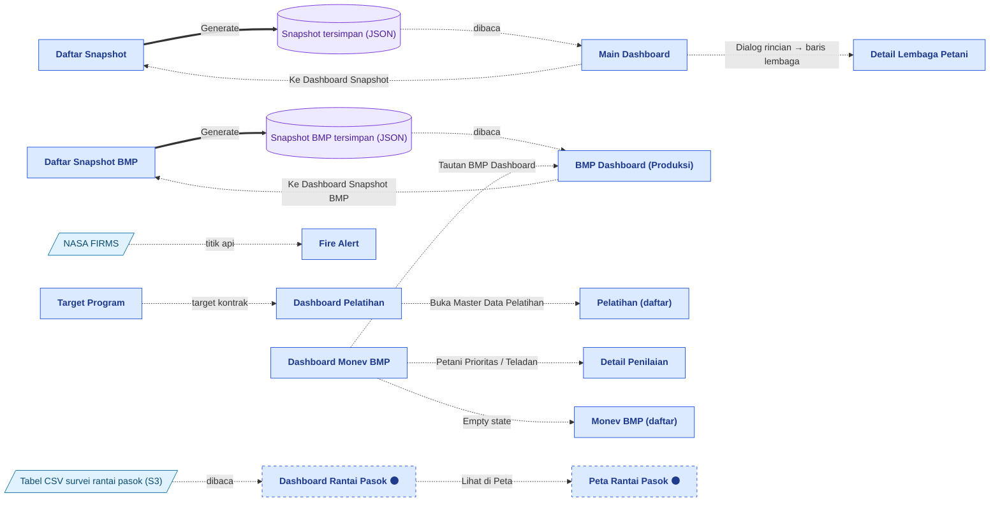

# Peta Fitur — Dashboard

> Bagian dari dokumentasi **Produk** · Peta fitur untuk Miro. Indeks: [README.md](README.md) · Legenda: [legend.md](legend.md) · Sumber: [../pages/dashboard/README.md](../pages/dashboard/README.md)

> **Ringkasan:** Menu pembuka aplikasi (order 0): ringkasan angka program untuk dibaca, tanpa tombol ubah data. Enam sub menu (+ Fire Alert sebagai level 3 di bawah Risk Management), enam halaman: dua membaca **snapshot** dari menu Tools (Main Dashboard, BMP Dashboard), tiga membaca DB langsung (Dashboard Pelatihan, Monev BMP, Fire Alert + NASA FIRMS), dan satu prototipe berbasis tabel CSV (Dashboard Rantai Pasok 🟠).

## Pohon navigasi

| Halaman | Route | Katalog |
|---|---|---|
| Main Dashboard | `/admin/dashboard/main` | [main.md](../pages/dashboard/main.md) |
| Dashboard Pelatihan | `/admin/dashboard/training` | [training.md](../pages/dashboard/training.md) |
| BMP Dashboard (Produksi) | `/admin/dashboard/bmp` | [bmp.md](../pages/dashboard/bmp.md) |
| Dashboard Monev BMP | `/admin/dashboard/bmp-monev` | [bmp-monev.md](../pages/dashboard/bmp-monev.md) |
| Fire Alert | `/admin/dashboard/risk/fire` | [risk/fire.md](../pages/dashboard/risk/fire.md) |
| Dashboard Rantai Pasok 🟠 | `/admin/dashboard/supply-chain` | [supply-chain.md](../pages/dashboard/supply-chain.md) |

Halaman induk `/admin/dashboard` (dan `/admin`) tidak punya isi; ia mengalihkan ke sub menu pertama yang boleh diakses (bawaan Main Dashboard). Grup **Risk Management** hanya wadah level 3 — tidak punya halaman sendiri. **Metrik Rilis** (`/admin/dashboard/metrics`) bukan bagian menu ini: di sidebar ia ada di grup Platform Developer.

## Main Dashboard

Kartu Petani, Lahan, dan Pelatihan tidak punya dialog rincian; kartu sertifikasi tidak ikut filter Tahun. Semua filter diiris di browser dari satu snapshot.

## Dashboard Pelatihan — bagian 1/2

## Dashboard Pelatihan — bagian 2/2

Dashboard Pelatihan membaca DB langsung (bukan snapshot); hanya daftar petani di dialog yang di-query saat dialog dibuka. Tombol Excel dan Salin hanya tampil bagi pengguna berizin EXPORT.

## BMP Dashboard (Produksi)

Tidak ada dialog di halaman ini. Semua filter diiris di browser dari satu snapshot BMP; tombol Excel hanya tampil bagi pengguna berizin EXPORT.

## Dashboard Monev BMP

Realtime (bukan snapshot). Daftar Petani Prioritas / Teladan dimuat terpisah saat seksi tampil (nama petani tidak ikut payload utama). Seksi 4 bernomor 3 bila Seksi 3 tidak tampil.

## Fire Alert

Tidak ada dialog; rincian kartu berupa tooltip. Titik api tidak disimpan di DB — diambil langsung dari NASA FIRMS tiap kali rentang berubah; deteksi dalam/luar boundary dihitung di browser (point-in-polygon). Seksi Print Map hanya tampil bagi pengguna berizin PRINT.

## Dashboard Rantai Pasok 🟠

Prototipe #379: datanya **bukan dari DB**, melainkan tabel CSV hasil konversi form survei 2025 yang dibaca dari S3 privat. Posisi lipat kartu dan tab terakhir diingat per browser (bukan URL); filter dibagi dengan Peta Rantai Pasok lewat URL. Tidak ada dialog.

## Alur lintas menu

Main Dashboard dan BMP Dashboard hanya berubah setelah snapshot baru dibuat di menu Tools (lihat [tools.md](tools.md)). Dashboard Pelatihan, Monev BMP, dan Fire Alert membaca data terkini — isi Master Data (Pelatihan, Monev BMP, Target Program) langsung tercermin. Setiap halaman punya tombol Panduan (?) ke tutorial Bantuan.

## Urutan demo yang disarankan

1. Masuk → otomatis mendarat di Main Dashboard; tunjukkan catatan tanggal snapshot dan 5 kartu tematik.
2. Klik baris Lembaga Petani ↗ → dialog rincian; cari satu lembaga, buka Detail Lembaga Petani di tab baru.
3. Pakai filter Distrik → kartu dan peta menyempit; klik marker di peta → panel info Lembaga.
4. Buka Dashboard Pelatihan: 4 KPI, Training Benefit (Tabel → Grafis → vs Kontrak), lalu klik sel merah di matriks Capaian Paket per Lembaga → dialog petani belum dilatih → Excel.
5. Buka BMP Dashboard (Produksi): ganti Tahun ke Rataan, lihat tren bulanan, Top 10, dan Ex-Plasma vs Swadaya per umur tanaman; tutup dengan tombol Excel.
6. Buka Monev BMP: Sebaran Kategori, Papan Lembaga (klik nama = filter), radar A vs B, Petani Prioritas → Detail Penilaian.
7. Buka Risk Management › Fire Alert: ganti rentang 5 hari → 30 hari → Bulan tertentu; klik baris lembaga di tabel → peta zoom; Cetak Laporan Bulanan (PDF).
8. Tutup dengan Dashboard Rantai Pasok 🟠: filter Distrik, tab Sankey → Diagram Alur, lalu Lihat di Peta untuk menyambung ke menu Map.
