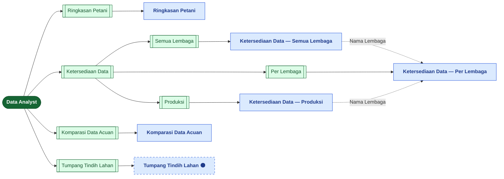
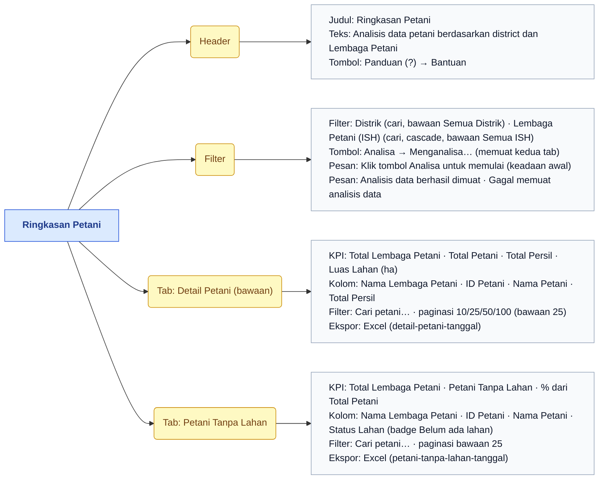
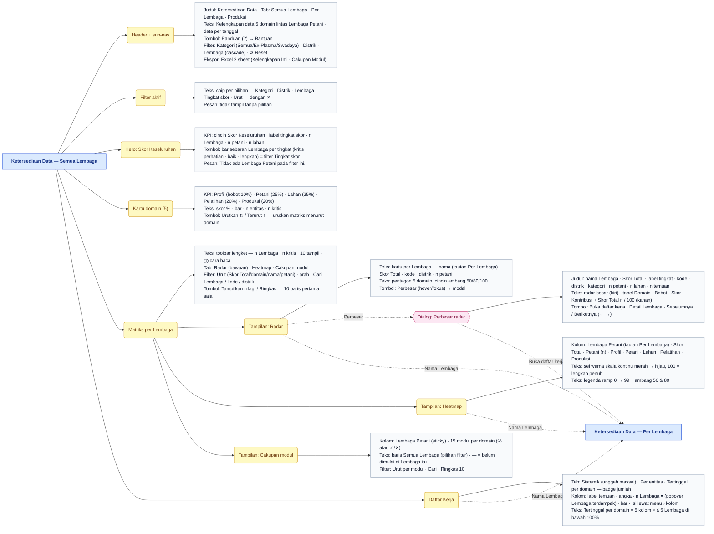
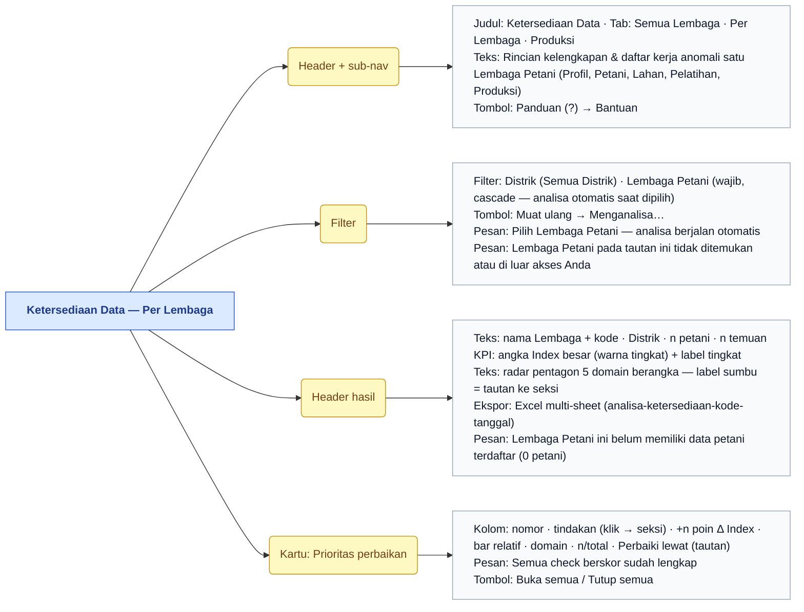
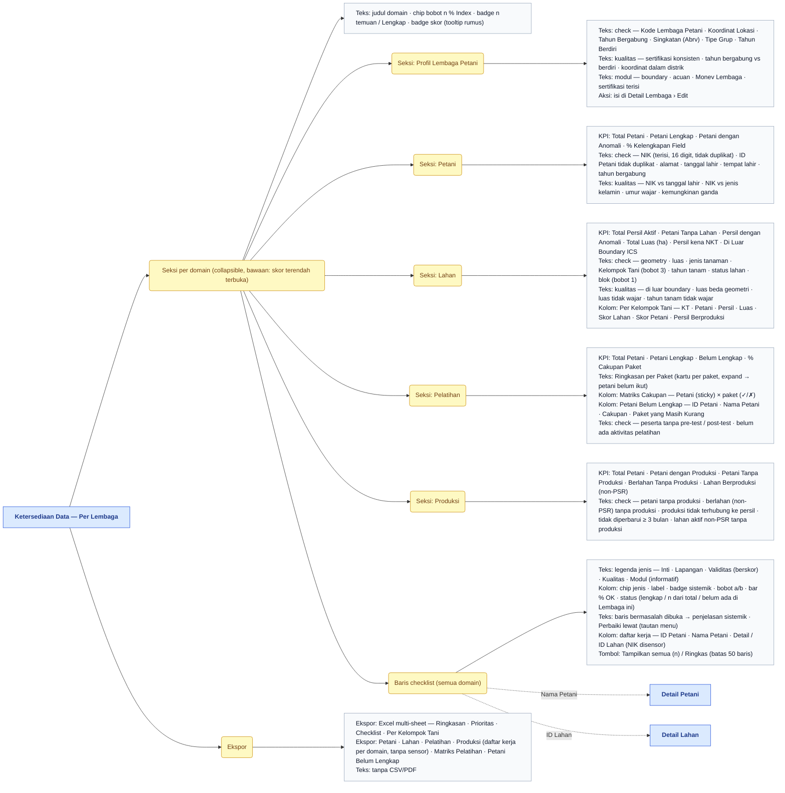
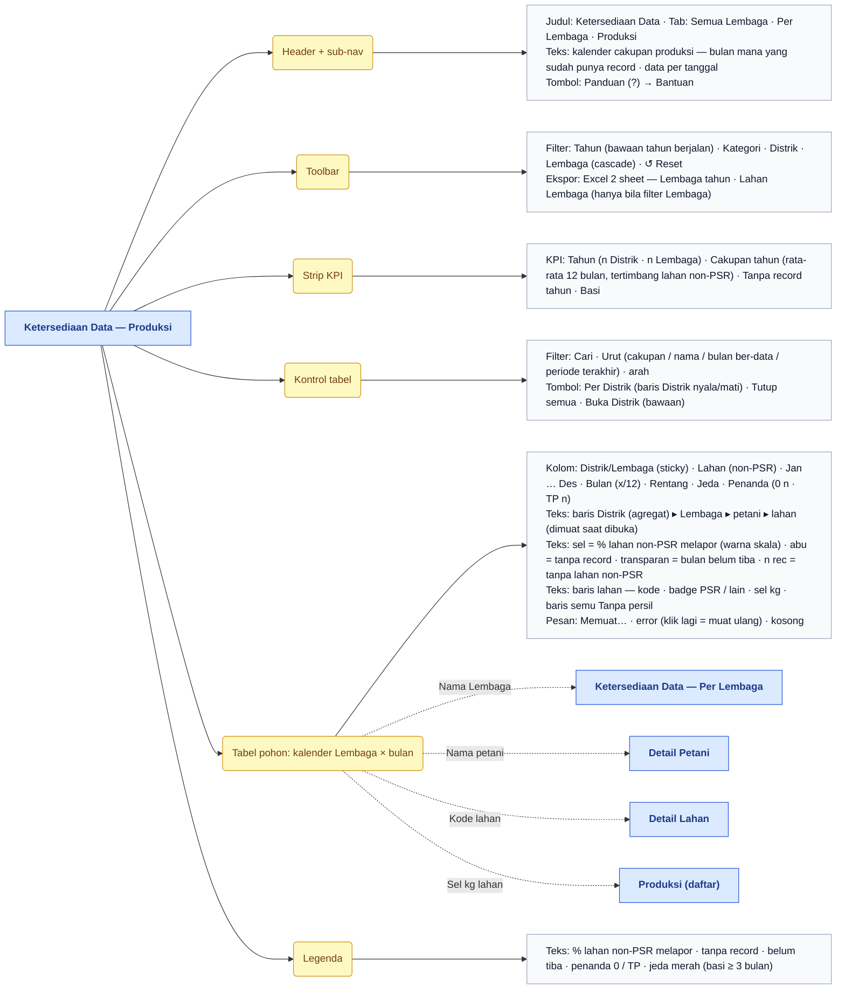
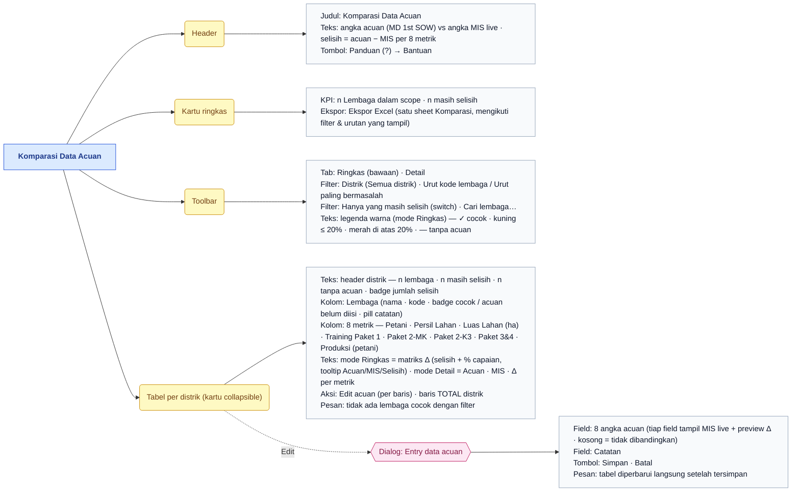
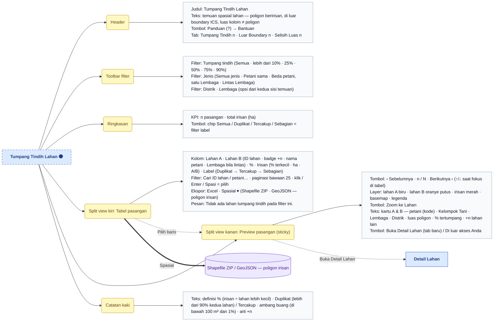
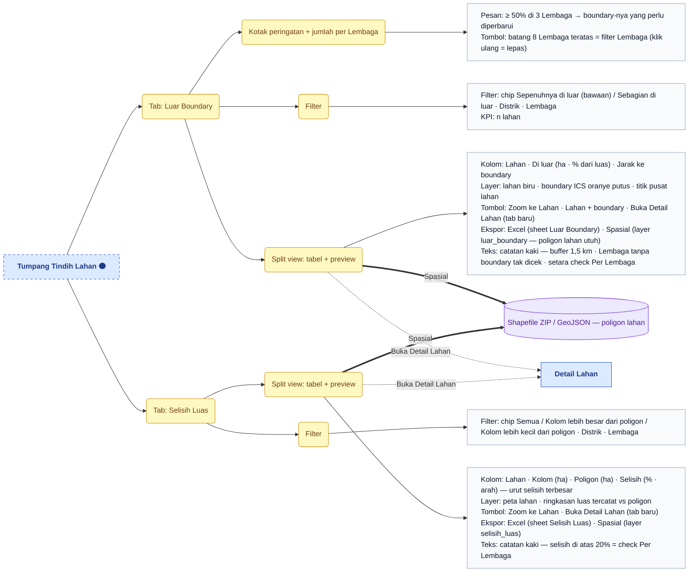
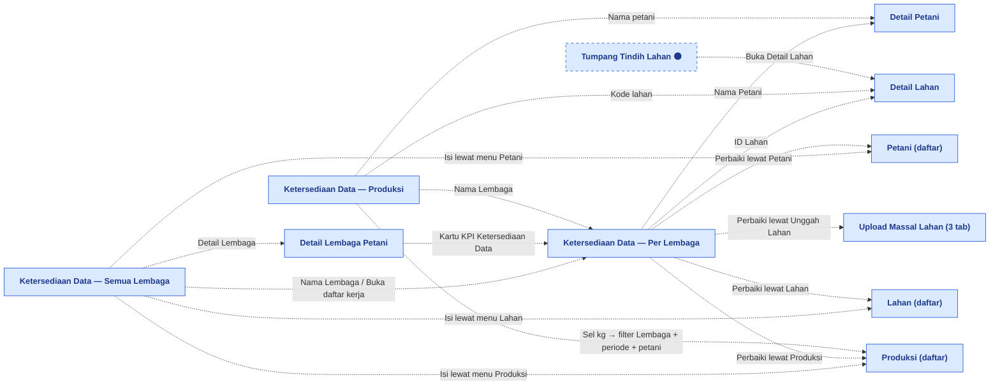

# Peta Fitur — Data Analyst

> Bagian dari dokumentasi **Produk** · Peta fitur untuk Miro. Indeks: [README.md](README.md) · Legenda: [legend.md](legend.md) · Sumber: [../pages/data-analyst/README.md](../pages/data-analyst/README.md)

> **Ringkasan:** Menu kerja analis data: memeriksa **kelengkapan, cakupan, dan kualitas** data yang sudah masuk — ringkasan petani per Lembaga, skor Ketersediaan Data (semua Lembaga → satu Lembaga → kalender produksi), komparasi dengan angka acuan, dan temuan spasial tumpang tindih lahan. Empat sub menu level 2 (satu di antaranya induk **Ketersediaan Data** dengan tiga anak level 3), enam halaman. Semua halaman membaca data secara live dan menautkan temuan ke halaman Master Data untuk diperbaiki.

## Pohon navigasi

| Halaman | Route | Katalog |
|---|---|---|
| Ringkasan Petani | `/admin/data-analyst/farmer-summary` | [farmer-summary.md](../pages/data-analyst/farmer-summary.md) |
| Ketersediaan Data — Semua Lembaga | `/admin/data-analyst/data-availability` | [data-availability.md](../pages/data-analyst/data-availability.md) |
| Ketersediaan Data — Per Lembaga | `/admin/data-analyst/data-completeness?lembaga={id}` | [data-completeness.md](../pages/data-analyst/data-completeness.md) |
| Ketersediaan Data — Produksi | `/admin/data-analyst/availability/production` | [availability-production.md](../pages/data-analyst/availability-production.md) |
| Komparasi Data Acuan | `/admin/data-analyst/benchmark-comparison` | [benchmark-comparison.md](../pages/data-analyst/benchmark-comparison.md) |
| Tumpang Tindih Lahan 🟠 | `/admin/data-analyst/parcel-overlap?tab={tab}` | [parcel-overlap.md](../pages/data-analyst/parcel-overlap.md) |

Halaman induk `/admin/data-analyst` tidak punya isi; ia mengalihkan ke sub menu pertama yang boleh diakses. Induk level 2 **Ketersediaan Data** (`/admin/data-analyst/availability`) juga hanya mengalihkan — ke **Semua Lembaga** (atau anak pertama yang boleh diakses). Ketiga anak Ketersediaan Data berbagi satu header `Ketersediaan Data` dengan sub-nav Semua Lembaga · Per Lembaga · Produksi. Tumpang Tindih Lahan berstatus 🟠 karena guard unggah dan layer Peta Lahan belum dikerjakan (#317 Fase 3–4). Metrik Rilis, Peta Data & Skema, dan Rencana Pengembangan **bukan** bagian menu ini (grup Platform Developer).

## Ringkasan Petani

## Ketersediaan Data — Semua Lembaga

## Ketersediaan Data — Per Lembaga — bagian 1/2

## Ketersediaan Data — Per Lembaga — bagian 2/2

## Ketersediaan Data — Produksi

## Komparasi Data Acuan

## Tumpang Tindih Lahan — bagian 1/2 (tab Tumpang Tindih)

## Tumpang Tindih Lahan — bagian 2/2 (tab Luar Boundary & Selisih Luas)

Status 🟠: ketiga tab sudah tersedia; yang belum adalah guard saat unggah shapefile (Fase 3) dan layer temuan di Peta Lahan (Fase 4).

## Alur lintas menu

Pola alurnya satu arah: **ringkasan → satu Lembaga → entitas**. Semua Lembaga dan Produksi menyerahkan konteks Lembaga ke Per Lembaga lewat `?lembaga=`; Per Lembaga dan Produksi menyerahkan entitas ke halaman Master Data (Detail Petani / Detail Lahan / Daftar Produksi berfilter) untuk diperbaiki; baris *Perbaiki lewat* dan *Isi lewat* menautkan ke menu pengisian (Master Data atau Bulk Upload). Kartu KPI Ketersediaan Data di Detail Lembaga Petani membuka Per Lembaga dengan Lembaga itu terpilih. Ringkasan Petani dan Komparasi Data Acuan berdiri sendiri (hanya ekspor Excel, tanpa tautan keluar).

## Urutan demo yang disarankan

1. Buka Data Analyst → Ringkasan Petani: pilih Distrik dan Lembaga, klik Analisa, tunjukkan dua tab (Detail Petani, Petani Tanpa Lahan) dan Excel per tab.
2. Buka Ketersediaan Data → Semua Lembaga: baca cincin Skor Keseluruhan dan bar sebaran, klik satu segmen tingkat skor (chip filter aktif muncul), klik Urutkan di kartu Lahan.
3. Di matriks yang sama ganti tampilan Radar → Heatmap → Cakupan modul, klik Perbesar pada satu radar, lalu Berikutnya di modal; tutup, buka Daftar Kerja dan tunjukkan tab Sistemik beserta popover *n Lembaga*.
4. Klik nama Lembaga (atau Buka daftar kerja) → Per Lembaga: angka Index + radar, Prioritas perbaikan, buka seksi berskor terendah, klik baris bermasalah → daftar kerja → Nama Petani membuka Detail Petani di Master Data.
5. Kembali, klik tab Produksi: pilih tahun, buka satu Distrik ▸ Lembaga ▸ petani ▸ lahan, tunjukkan sel kg yang membuka Daftar Produksi berfilter; unduh Excel 2 sheet dengan filter Lembaga.
6. Buka Komparasi Data Acuan: mode Ringkas vs Detail, aktifkan *Hanya yang masih selisih*, klik Edit pada satu Lembaga, ubah satu angka (preview Δ berubah), Simpan.
7. Buka Tumpang Tindih Lahan: filter lebih dari 50% dan chip Duplikat, pilih baris → preview peta A/B/irisan, Berikutnya dengan ↓, Buka Detail Lahan; unduh Spasial → GeoJSON.
8. Pindah ke tab Luar Boundary (klik batang Lembaga teratas) dan Selisih Luas, tutup dengan catatan kaki bahwa keduanya memakai check yang sama dengan Per Lembaga.
