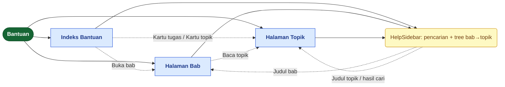
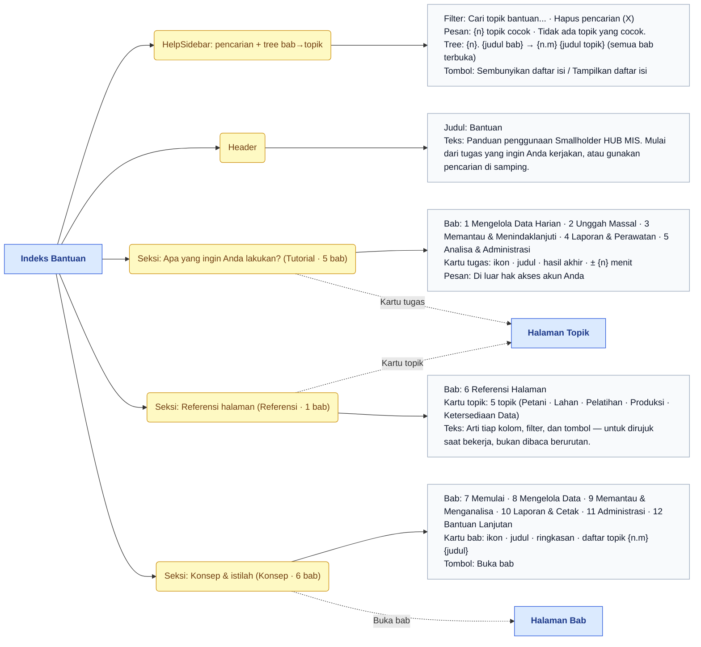
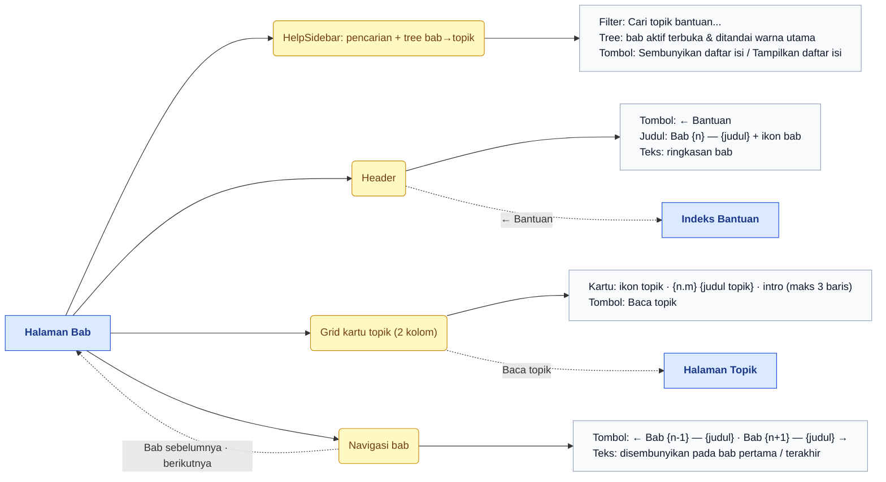
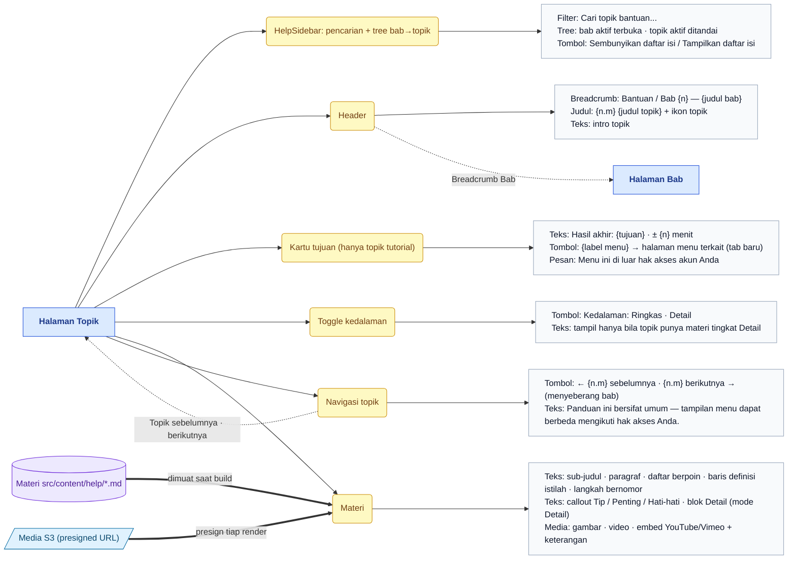
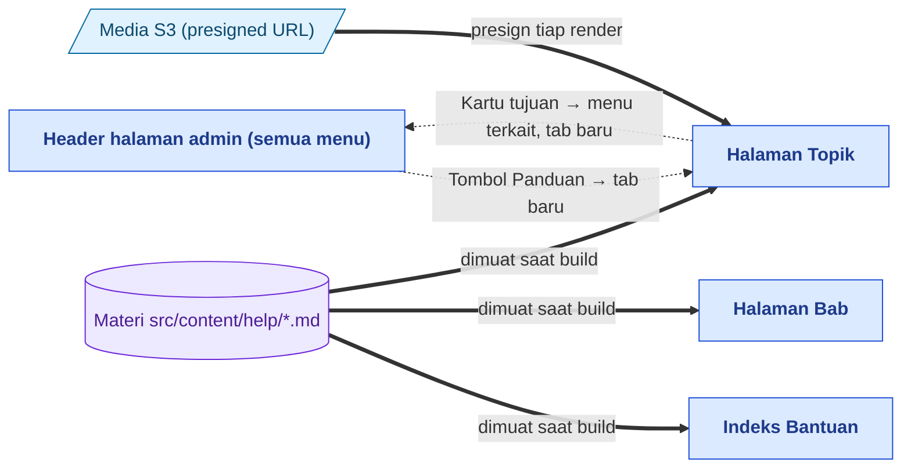

# Peta Fitur — Bantuan

> Bagian dari dokumentasi **Produk** · Peta fitur untuk Miro. Indeks: [README.md](README.md) · Legenda: [legend.md](legend.md) · Sumber: [../pages/help/README.md](../pages/help/README.md)

> **Ringkasan:** Panduan penggunaan MIS di dalam aplikasi, tiga lapis materi — **Tutorial** (5 bab, per tugas), **Referensi** (1 bab, arti kolom & tombol), **Konsep** (6 bab, istilah & aturan main) — total 12 bab. Menu tunggal tanpa sub menu; tiga halaman: Indeks Bantuan, Halaman Bab, Halaman Topik, semuanya memakai sidebar bersama berisi pencarian dan pohon bab → topik.

## Pohon navigasi

| Halaman | Route | Katalog |
|---|---|---|
| Indeks Bantuan | `/admin/help` | [index.md](../pages/help/index.md) |
| Halaman Bab | `/admin/help/{chapter}` | [chapter.md](../pages/help/chapter.md) |
| Halaman Topik | `/admin/help/{chapter}/{topic}` | [topic.md](../pages/help/topic.md) |

Menu Bantuan tidak punya sub menu di sidebar; `/admin/help` adalah halaman Indeks itu sendiri (bukan redirect). Slug bab/topik yang tak dikenal menampilkan halaman 404.

## Indeks Bantuan

## Halaman Bab

## Halaman Topik

## Alur lintas menu

Tombol **Panduan (?)** di header tiap halaman admin membuka Halaman Topik tutorial yang membahas menu itu (dicari dari `menuKey` materi lapis tutorial; tidak dirender bila menu belum punya tutorial). Sebaliknya, kartu tujuan di topik tutorial membawa pengguna kembali ke halaman menu terkait. Materi tiga lapis ditulis sebagai Markdown di `src/content/help/` dan dibundel saat build — perubahan materi tampil setelah build ulang; gambar/video privat memakai sintaks `s3://` dan ditukar presigned URL pada tiap render topik.

## Urutan demo yang disarankan

1. Buka Bantuan dari sidebar: tunjukkan tiga seksi Indeks — tugas (Tutorial), Referensi halaman, Konsep & istilah — dan sidebar dengan semua bab terbuka.
2. Ketik di `Cari topik bantuan...` (mis. "produksi"), tunjukkan jumlah `{n} topik cocok` dan klik satu hasil.
3. Di Halaman Topik: breadcrumb, kartu tujuan (`Hasil akhir`, durasi, tombol ke menu terkait), lalu ganti `Kedalaman` Ringkas → Detail.
4. Pakai navigasi topik berikutnya hingga menyeberang bab; klik breadcrumb bab untuk kembali ke Halaman Bab dan tunjukkan `Baca topik` + navigasi bab ← →.
5. Kembali ke Indeks, buka kartu bab Konsep lewat `Buka bab`, tunjukkan penanda `Di luar hak akses akun Anda` pada akun terbatas.
6. Pindah ke halaman menu lain (mis. Master Data › Petani), klik `Panduan (?)` di header: tutorial terkait terbuka di tab baru.
