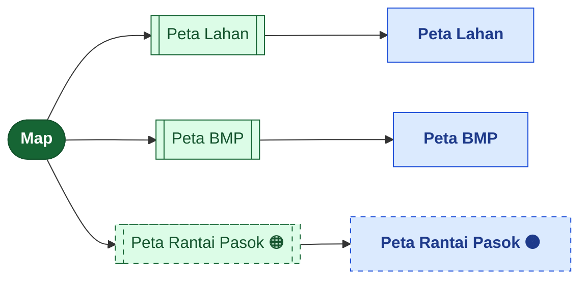
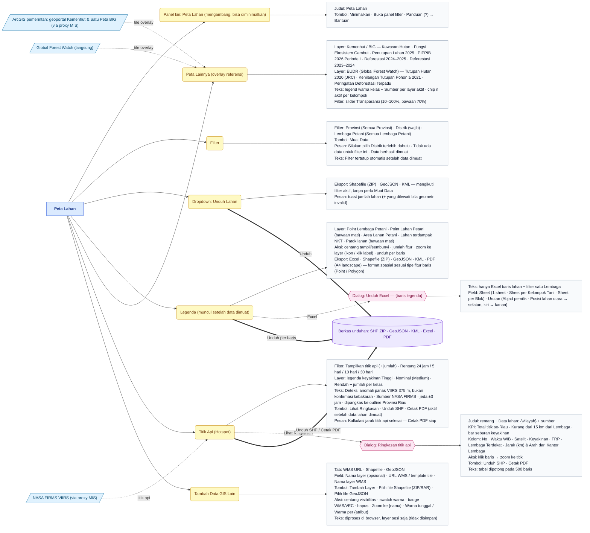
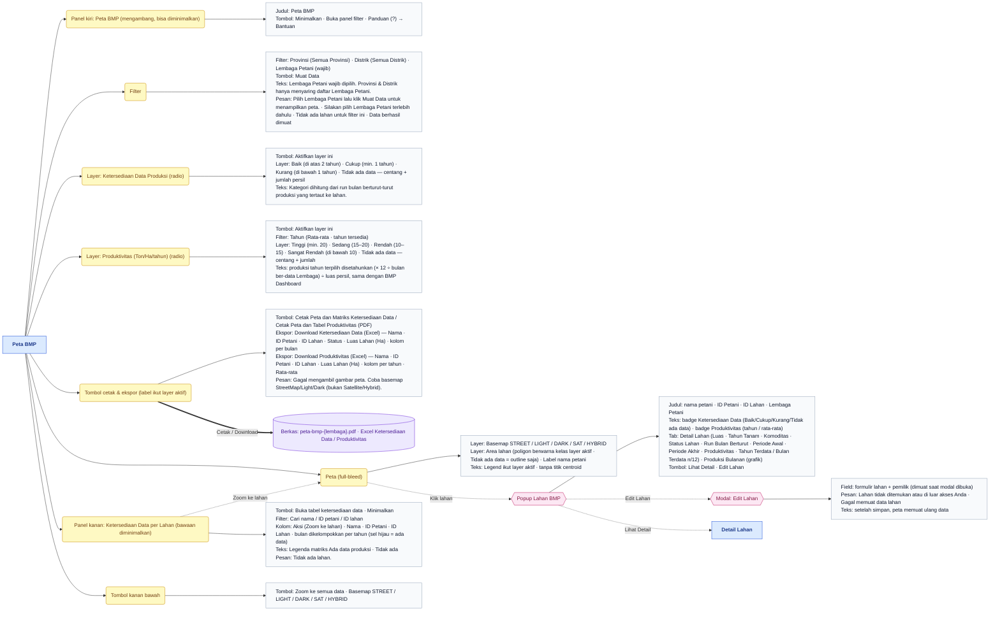
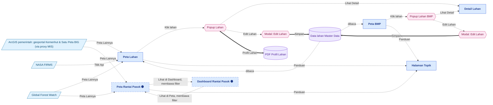

# Peta Fitur — Map

> Bagian dari dokumentasi **Produk** · Peta fitur untuk Miro. Indeks: [README.md](README.md) · Legenda: [legend.md](legend.md) · Sumber: [../pages/map/README.md](../pages/map/README.md)

> **Ringkasan:** Menu peta interaktif: **Peta Lahan** menampilkan sebaran Lembaga, lahan, lahan terdampak NKT, dan patok dengan overlay referensi pemerintah/EUDR dan titik api NASA FIRMS; **Peta BMP** mewarnai poligon lahan satu Lembaga menurut ketersediaan data produksi atau produktivitas; **Peta Rantai Pasok** (prototipe) menggambar aliran TBS Lembaga → agen/RAMP → Mill dari tabel survei. Tiga sub menu, tiga halaman (masing-masing satu halaman peta full-bleed tanpa daftar/detail terpisah).

## Pohon navigasi

| Halaman | Route | Katalog |
|---|---|---|
| Peta Lahan | `/admin/map/parcel` | [parcel.md](../pages/map/parcel.md) |
| Peta BMP | `/admin/map/bmp` | [bmp.md](../pages/map/bmp.md) |
| Peta Rantai Pasok 🟠 | `/admin/map/supply-chain` | [supply-chain.md](../pages/map/supply-chain.md) |

Halaman induk `/admin/map` tidak punya isi; ia mengalihkan ke sub menu pertama (urut `order`) yang boleh diakses pengguna. Ketiga peta memakai basemap yang sama (STREET / LIGHT / DARK / SAT / HYBRID; bawaan mengikuti tema aplikasi) dan popup lahan terstandar dengan aksi **Lihat Detail** / **Edit Lahan**.

## Peta Lahan — bagian 1/2 (panel kiri)

## Peta Lahan — bagian 2/2 (peta, popup, panel kanan, tombol)

```mermaid
%%{init: {"flowchart": {"wrappingWidth": 420}}}%%
flowchart LR
  mp_parcel["Peta Lahan"]:::page

  mp_parcel_map("Peta (full-bleed)"):::section
  mp_parcel_map_c["Layer: Basemap STREET / LIGHT / DARK / SAT / HYBRID<br/>Layer: Point Lembaga Petani (hijau) · Point Lahan Petani (biru) · Area Lahan Petani (ungu) · Lahan terdampak NKT (merah) · Patok lahan (kuning)<br/>Layer: Overlay Peta Lainnya · Titik api · Layer GIS tambahan · Highlight lahan terpilih (kuning, selalu tampil)<br/>Teks: label nama lembaga di bawah titik · nama petani di dalam poligon bila muat · Legend"]:::content

  mp_parcel_popup_other{{"Popup fitur: Lembaga Petani · Titik Api · Patok"}}:::dialog
  mp_parcel_popup_other_c["Lembaga Petani: Kode · Distrik · Koordinat<br/>Titik Api: usia deteksi · Waktu Deteksi (WIB) · Satelit · Keyakinan · FRP · Koordinat · catatan sumber FIRMS<br/>Patok: kode patok · Lahan · No · Kondisi · Koordinat<br/>Teks: popup bisa digeser lewat pegangan"]:::content

  mp_parcel_popup{{"Popup Lahan"}}:::dialog
  mp_parcel_popup_c["Judul: nama petani · ID Petani · ID Lahan · Lembaga Petani · Luas Lahan (ha)<br/>Tab: Detail Lahan (Tahun Tanam · Komoditas · Status Lahan · NKT · Patok) · Pelatihan Petani (paket + centang + tanggal) · Produksi (Rata-rata / per tahun, grafik batang bulanan kg)<br/>Tombol: Profil Lahan (PDF) · Lihat Detail · Edit Lahan<br/>Pesan: Gagal memuat pelatihan. · Belum ada data produksi. · Gagal membuat PDF profil lahan"]:::content

  mp_parcel_edit{{"Modal: Edit Lahan"}}:::dialog
  mp_parcel_edit_c["Field: formulir lahan + pemilik (dimuat saat modal dibuka)<br/>Pesan: Lahan tidak ditemukan atau di luar akses Anda · Gagal memuat data lahan<br/>Teks: setelah simpan, peta memuat ulang data dengan filter aktif"]:::content

  mp_parcel_passport[("PDF Profil Lahan: kartu ringkasan · Layout Lahan + tetangga · Legalitas & Dokumen · Pelatihan · Produksi")]:::data

  mp_parcel_ruler("Panel kanan atas: Ukur jarak & luas"):::section
  mp_parcel_ruler_c["Tombol: toggle Ukur jarak & luas · Hapus titik terakhir · Hapus ukuran<br/>Teks: Jarak (≥ 2 titik) · Luas (≥ 3 titik) · Klik pada peta untuk mulai mengukur. · {n} titik · klik menambah · Esc selesai."]:::content

  mp_parcel_list("Panel kanan atas: Daftar Lahan (n)"):::section
  mp_parcel_list_c["Filter: Cari nama / ID petani / ID lahan<br/>Kolom: Aksi (Zoom ke lahan) · Petani (nama + kode) · ID Lahan<br/>Pesan: Tidak ada lahan."]:::content

  mp_parcel_tools("Tombol kanan bawah"):::section
  mp_parcel_tools_c["Tombol: Terrain 3D (relief AWS Terrain Tiles) · Kompas — Kembali ke utara & tampilan 2D · Putar kiri 30° · Putar kanan 30° · Miringkan 15° (3D) · Tegakkan 15° (2D) · Zoom ke semua data<br/>Tombol: Basemap STREET / LIGHT / DARK / SAT / HYBRID<br/>Teks: SAT & HYBRID menggagalkan capture cetak PDF"]:::content

  mp_ext_basemap[/"Tile basemap: OpenStreetMap · OpenFreeMap · Google (SAT/HYBRID) · AWS Terrain Tiles"/]:::external
  md_parcels_detail["Detail Lahan"]:::page

  mp_parcel --> mp_parcel_map --> mp_parcel_map_c
  mp_parcel_map -.->|Klik fitur| mp_parcel_popup_other --> mp_parcel_popup_other_c
  mp_parcel_map -.->|Klik lahan| mp_parcel_popup --> mp_parcel_popup_c
  mp_parcel_popup -.->|Edit Lahan| mp_parcel_edit --> mp_parcel_edit_c
  mp_parcel_popup ==>|Profil Lahan| mp_parcel_passport
  mp_parcel_popup -.->|Lihat Detail| md_parcels_detail
  mp_parcel --> mp_parcel_ruler --> mp_parcel_ruler_c
  mp_parcel --> mp_parcel_list --> mp_parcel_list_c
  mp_parcel_list -.->|Zoom ke lahan| mp_parcel_map
  mp_parcel --> mp_parcel_tools --> mp_parcel_tools_c
  mp_ext_basemap -.->|tile| mp_parcel_map

  classDef page fill:#dbeafe,stroke:#1d4ed8,color:#1e3a8a,font-weight:bold
  classDef section fill:#fef9c3,stroke:#ca8a04,color:#713f12
  classDef content fill:#f8fafc,stroke:#94a3b8,color:#0f172a,text-align:left
  classDef dialog fill:#fce7f3,stroke:#be185d,color:#831843
  classDef data fill:#ede9fe,stroke:#6d28d9,color:#4c1d95
  classDef external fill:#e0f2fe,stroke:#0369a1,color:#0c4a6e
```

## Peta BMP

## Peta Rantai Pasok 🟠

```mermaid
%%{init: {"flowchart": {"wrappingWidth": 420}}}%%
flowchart LR
  mp_supply["Peta Rantai Pasok 🟠"]:::page

  mp_supply_hdr("Panel kiri (bisa dilipat)"):::section
  mp_supply_hdr_c["Judul: Peta Rantai Pasok + badge Prototipe · Panduan (?) → Bantuan<br/>KPI: total TBS · % tergambar · tautan Dashboard (membawa filter)<br/>Tab: Ringkas (Lembaga → Mill) · Detail (singgah agen/RAMP bertitik + titik lahan)<br/>Teks: chip Menyorot: … (✕) saat jaringan disorot · posisi lipat tiap bagian diingat per browser"]:::content

  mp_supply_filter("Filter (terbuka bawaan, sama dengan Dashboard)"):::section
  mp_supply_filter_c["Filter: Distrik · Kategori (Swadaya/Ex-Plasma) · UL & Non-UL · Tahun<br/>Filter: Lembaga › Agen·KT/Koperasi › RAMP › Mill (faset)<br/>Tombol: ↺ Reset<br/>Teks: tersimpan di URL, peta menyesuaikan tiap filter berubah"]:::content

  mp_supply_layers("Lapisan"):::section
  mp_supply_layers_c["Filter: garis alir · animasi arah · label · titik lahan · garis lahan → Mill<br/>Teks: saklar diingat per browser"]:::content

  mp_supply_overlay("Peta Lainnya (overlay referensi, sama dengan Peta Lahan)"):::section
  mp_supply_overlay_c["Layer: Kemenhut / BIG — Kawasan Hutan · Fungsi Ekosistem Gambut · Penutupan Lahan 2025 · PIPPIB 2026 Periode I · Deforestasi 2024–2025 · Deforestasi 2023–2024<br/>Layer: EUDR (Global Forest Watch) — Tutupan Hutan 2020 (JRC) · Kehilangan Tutupan Pohon ≥ 2021 · Peringatan Deforestasi Terpadu<br/>Teks: legend + Sumber per layer · visual saja (belum ada hitungan tumpang tindih) · tidak diingat<br/>Filter: slider Transparansi"]:::content

  mp_supply_legend("Legenda (panel) & Ringkasan"):::section
  mp_supply_legend_c["Legenda: warna jalur · contoh tebal garis 3 tonase · titik Lembaga / offtaker · 3 ikon Mill<br/>Ringkasan: tonase tergambar / tidak tergambar · daftar nama Mill tanpa koordinat · Lembaga tanpa titik · offtaker dilewati tanpa titik + tonase"]:::content

  mp_supply_map("Peta (full-bleed)"):::section
  mp_supply_map_c["Layer: garis alir melengkung — warna = jalur · tebal ∝ √tonase · dash putih beranimasi (arah) / panah bila animasi mati<br/>Layer: titik Lembaga · offtaker bertitik · ikon pabrik Mill (biru UL · abu · abu muda putus-putus = PKS belum pasti) + halo ∝ tonase · titik lahan (bertepi gelap = koordinat survei)<br/>Layer: label selektif — 8 terbesar per jenis selalu, sisanya zoom ≥ 10<br/>Aksi: hover = tooltip nama + tonase & garis menyala · klik node = sorot jaringan, sisanya diredupkan"]:::content

  mp_supply_popup{{"Popup: Mill · Lembaga · offtaker · lahan · garis"}}:::dialog
  mp_supply_popup_c["Mill: badge UL · UML ID · Distrik · porsi · status · RSPO · Lembaga·offtaker · jarak rata-rata · Lembaga teratas<br/>Lembaga: porsi · % UL · % PKS pasti · offtaker utama · jarak · Mill tujuan<br/>offtaker: aksi hanya bila tertangkap filter · pembeli kedua non-RAMP → keterangan<br/>Tombol: Jadikan filter · Lihat di Dashboard<br/>Teks: auto-pan di kanan panel, bisa digeser"]:::content

  mp_supply_ctrl("Tumpukan kontrol kanan atas"):::section
  mp_supply_ctrl_c["Tombol: zoom +/− · Paskan · Lapisan (popover saklar + Peta Lainnya) · Basemap (popover STREET / LIGHT / DARK / SAT / HYBRID)"]:::content

  mp_supply_strip("Strip legenda mendatar (bawah tengah)"):::section
  mp_supply_strip_c["Legenda: warna jalur · Lembaga · offtaker · 3 ikon Mill<br/>Tombol: ✕ sembunyikan ↔ chip Legenda (diingat per browser)<br/>Teks: digeser ke kanan selebar panel saat panel terbuka"]:::content

  mp_supply_src[("Tabel CSV survei rantai pasok 2025 (lokal / S3 privat), bukan DB · titik lahan dari poligon MIS")]:::data
  db_supply["Dashboard Rantai Pasok 🟠"]:::page

  mp_supply --> mp_supply_hdr --> mp_supply_hdr_c
  mp_supply --> mp_supply_filter --> mp_supply_filter_c
  mp_supply --> mp_supply_layers --> mp_supply_layers_c
  mp_supply --> mp_supply_overlay --> mp_supply_overlay_c
  mp_supply --> mp_supply_legend --> mp_supply_legend_c
  mp_supply --> mp_supply_map --> mp_supply_map_c
  mp_supply_map -.->|Klik node / garis| mp_supply_popup --> mp_supply_popup_c
  mp_supply_popup -.->|Jadikan filter| mp_supply_filter
  mp_supply_popup -.->|Lihat di Dashboard| db_supply
  mp_supply_hdr -.->|Dashboard| db_supply
  mp_supply --> mp_supply_ctrl --> mp_supply_ctrl_c
  mp_supply --> mp_supply_strip --> mp_supply_strip_c
  mp_supply_src -.->|dibaca| mp_supply
  mp_ext_gov -.->|tile overlay| mp_supply_overlay
  mp_ext_gfw -.->|tile overlay| mp_supply_overlay

  mp_ext_gov[/"ArcGIS pemerintah: geoportal Kemenhut & Satu Peta BIG (via proxy MIS)"/]:::external
  mp_ext_gfw[/"Global Forest Watch (langsung)"/]:::external

  class mp_supply proto
  class db_supply proto

  classDef page fill:#dbeafe,stroke:#1d4ed8,color:#1e3a8a,font-weight:bold
  classDef section fill:#fef9c3,stroke:#ca8a04,color:#713f12
  classDef content fill:#f8fafc,stroke:#94a3b8,color:#0f172a,text-align:left
  classDef dialog fill:#fce7f3,stroke:#be185d,color:#831843
  classDef data fill:#ede9fe,stroke:#6d28d9,color:#4c1d95
  classDef external fill:#e0f2fe,stroke:#0369a1,color:#0c4a6e
  classDef proto stroke-dasharray:5 5
```

Garis di peta ini = garis lurus (dilengkungkan agar tidak tumpang tindih) menurut data pengakuan survei, bukan rute angkut.

## Alur lintas menu

- **Lihat Detail** di popup Peta Lahan & Peta BMP membuka halaman Detail Lahan di Master Data › Lahan; **Edit Lahan** menyimpan ke data lahan yang sama lalu peta memuat ulang (lihat [master-data.md](master-data.md)).
- Filter Peta Rantai Pasok dan Dashboard Rantai Pasok sama dan saling terbawa lewat URL (lihat [dashboard.md](dashboard.md)).
- Proxy titik api NASA FIRMS juga dipakai Dashboard Fire Alert; overlay Peta Lainnya dipakai bersama Peta Lahan dan Peta Rantai Pasok.
- Peta Sebaran Lahan di detail Lembaga/Petani (Master Data) memakai popup lahan dan aksi yang sama, tetapi berada di menu Master Data.

## Urutan demo yang disarankan

1. Buka Map → Peta Lahan: pilih Distrik (wajib), opsional Lembaga Petani, klik **Muat Data**; peta auto-zoom, panel Filter tertutup, Legenda muncul.
2. Mainkan Legenda: nyalakan Point Lahan & Patok lahan (dimuat malas), klik label untuk zoom ke layer, tunjukkan ikon unduh per baris (Excel per Kelompok Tani / Blok, Shapefile, PDF).
3. Klik satu lahan: popup Detail Lahan → tab Pelatihan & Produksi → **Profil Lahan** (PDF) → **Lihat Detail** ke Master Data › Lahan → **Edit Lahan** dari popup, simpan, peta memuat ulang.
4. Buka **Peta Lainnya**: centang Kawasan Hutan (Kemenhut) dan Tutupan Hutan 2020 (GFW), geser Transparansi; lalu **Titik Api** 30 hari → tunggu kalkulasi jarak → Ringkasan titik api → Cetak PDF.
5. Tunjukkan Tambah Data GIS Lain (WMS/Shapefile/GeoJSON), Ukur jarak & luas, Daftar Lahan, Terrain 3D + kompas/putar/miring, ganti basemap SAT.
6. Pindah ke Peta BMP: pilih Lembaga Petani (wajib) → Muat Data; ganti radio Ketersediaan Data ↔ Produktivitas (pilih Tahun), buka panel matriks kanan, lalu Cetak Peta (PDF) dan Download Excel.
7. Tutup dengan Peta Rantai Pasok (prototipe): toggle Ringkas ↔ Detail, klik satu Mill untuk menyorot jaringannya, **Jadikan filter**, lalu **Lihat di Dashboard**.
