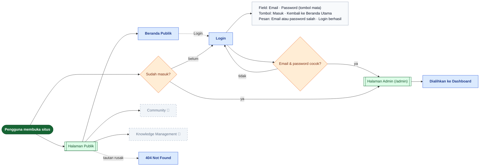
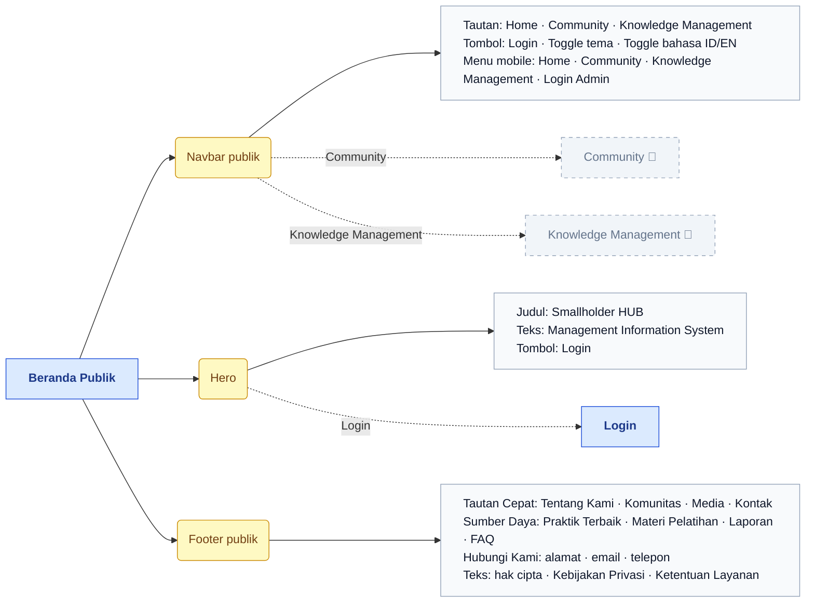
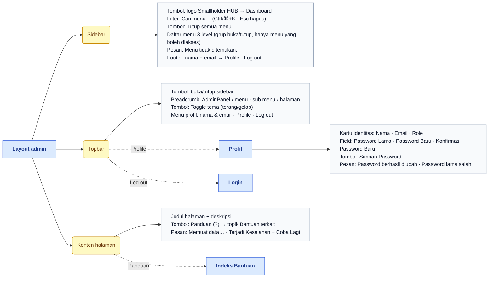
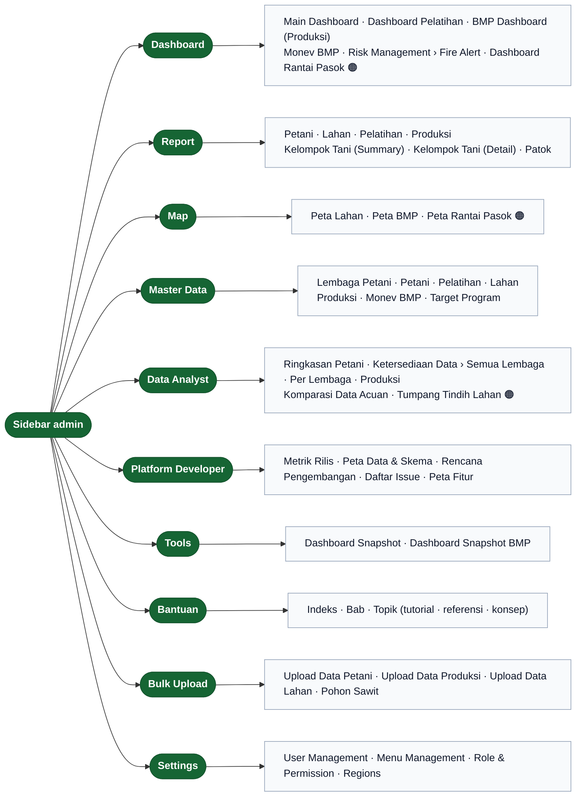
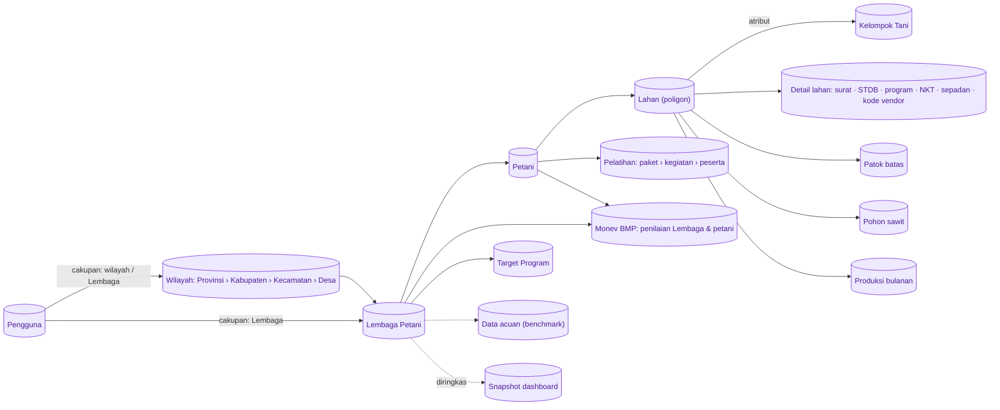

# Peta Fitur — Ikhtisar Sistem

> Bagian dari dokumentasi **Produk** · Peta fitur untuk Miro. Indeks: [README.md](README.md) · Legenda: [legend.md](legend.md) · Sumber: [../navigation.md](../navigation.md) · [../pages/non-menu/README.md](../pages/non-menu/README.md)

> **Ringkasan:** Gambar besar sebelum masuk ke per menu: dua wilayah halaman (publik vs admin), alur masuk, kerangka layout yang tampil di semua halaman admin, sepuluh menu sidebar, dan relasi entitas data yang dikelola. Ini padanan baris atas site map lama (kotak entitas + percabangan Public Page / Restricted Page).

## Wilayah halaman & alur masuk

| Halaman | Route | Status | Katalog |
|---|---|---|---|
| Beranda Publik | `/` | ✅ | [home.md](../pages/non-menu/home.md) |
| Community | `/community` | 🔲 | [community.md](../pages/non-menu/community.md) |
| Knowledge Management | `/knowledge-management` | 🔲 | [knowledge-management.md](../pages/non-menu/knowledge-management.md) |
| Login | `/login` | ✅ | [login.md](../pages/non-menu/login.md) |
| Halaman admin | `/admin/**` | ✅ | [pages/README.md](../pages/README.md) |
| 404 | route tak dikenal | ✅ | [non-menu/README.md](../pages/non-menu/README.md) |

Semua halaman admin berada di balik sesi NextAuth. Pengguna yang sudah masuk dan membuka `/login` otomatis diarahkan ke `/admin`, yang lalu mengalihkan ke Dashboard.

## Halaman publik

Community dan Knowledge Management masih halaman penampung: tautan di navbar sudah ada, isinya belum dibangun.

## Layout bersama halaman admin

Kerangka yang tampil di **setiap** halaman admin. Di Miro, cukup digambar sekali di frame ikhtisar; diagram per menu tidak mengulanginya.

| Halaman | Route | Katalog |
|---|---|---|
| Profil | `/admin/profile` | [profile.md](../pages/non-menu/profile.md) |

Sidebar hanya menampilkan menu yang boleh diakses pengguna; daftar dan urutannya diatur di Settings → Menu Management dan Role & Permission (lihat [settings.md](settings.md)).

## Sepuluh menu sidebar

Urutan mengikuti kolom `order` di sidebar. Tiap menu punya berkas sendiri di folder ini.

| Order | Menu | Sub menu | Berkas peta |
|---|---|---|---|
| 0 | Dashboard | 6 (+ Fire Alert level 3) | [dashboard.md](dashboard.md) |
| 1 | Report | 7 | [report.md](report.md) |
| 2 | Map | 3 | [map.md](map.md) |
| 3 | Master Data | 7 | [master-data.md](master-data.md) |
| 4 | Data Analyst | 4 (+ 3 level 3) | [data-analyst.md](data-analyst.md) |
| 5 | Platform Developer | 5 | [platform-developer.md](platform-developer.md) |
| 6 | Tools | 2 | [tools.md](tools.md) |
| 9 | Bantuan | — | [help.md](help.md) |
| 10 | Bulk Upload | 4 | [bulk-upload.md](bulk-upload.md) |
| 99 | Settings | 4 | [settings.md](settings.md) |

## Relasi entitas data

Padanan kotak `User → KT → Farmer → Kebun` di site map lama, disesuaikan dengan istilah yang dipakai aplikasi sekarang (Lembaga Petani = organisasi; Kelompok Tani = atribut per lahan di bawahnya).

| Entitas | Dikelola di | Dibaca di |
|---|---|---|
| Pengguna, cakupan data | Settings → User Management | semua menu (filter otomatis) |
| Wilayah | Settings → Regions | filter Distrik di dashboard, laporan, peta |
| Lembaga Petani, Petani, Lahan, Pelatihan, Produksi, Monev BMP, Target Program | Master Data (+ Bulk Upload) | Dashboard, Report, Map, Data Analyst |
| Patok, pohon, detail lahan | Master Data → Lahan (detail) + Bulk Upload | Peta Lahan, Report → Patok |
| Data acuan | Data Analyst → Komparasi Data Acuan | halaman yang sama |
| Snapshot dashboard | Tools | Main Dashboard, BMP Dashboard |

## Urutan demo yang disarankan

1. Buka beranda publik, tunjukkan navbar dan tombol Login.
2. Masuk dengan akun; tunjukkan pengalihan ke Dashboard.
3. Kenalkan layout: sidebar (cari menu, buka/tutup grup), breadcrumb, tema, menu profil.
4. Jelaskan sepuluh menu dalam satu kalimat masing-masing (pakai diagram "Sepuluh menu sidebar").
5. Tutup dengan relasi entitas: data masuk lewat Master Data/Bulk Upload, dibaca oleh Dashboard/Report/Map/Data Analyst.
6. Lanjut ke episode per menu sesuai urutan berkas di [README.md](README.md).
