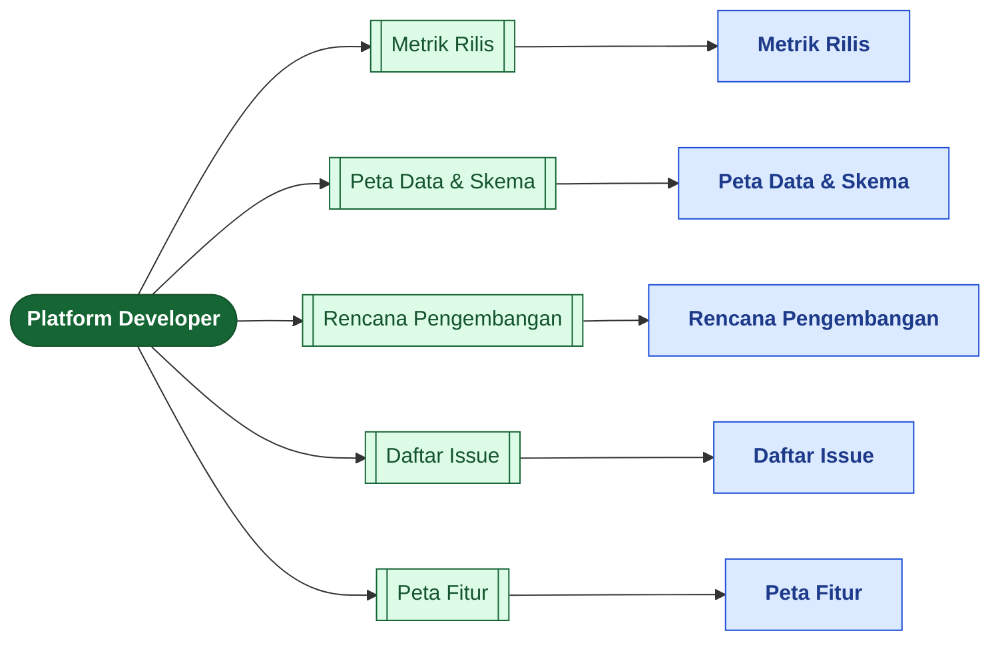
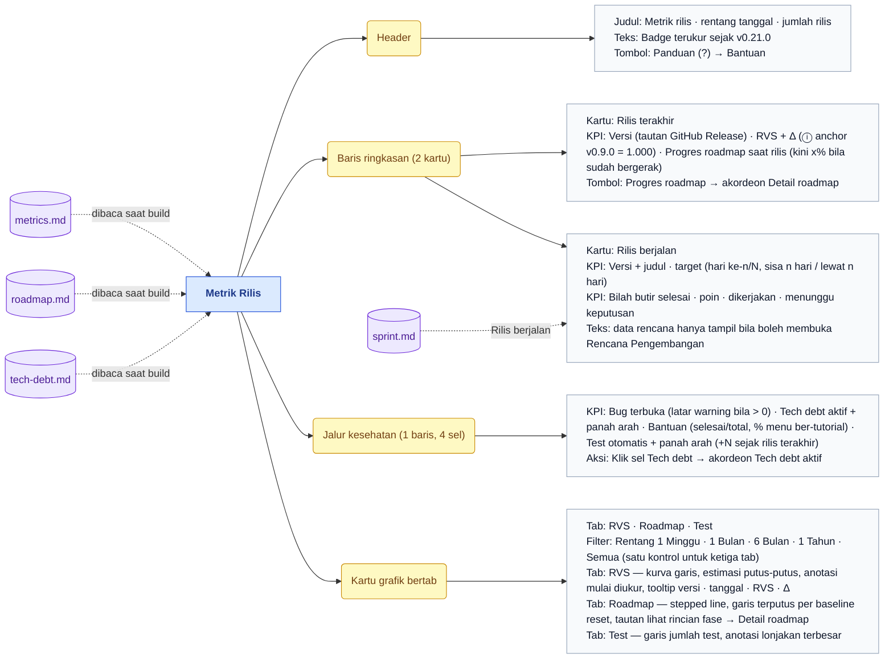
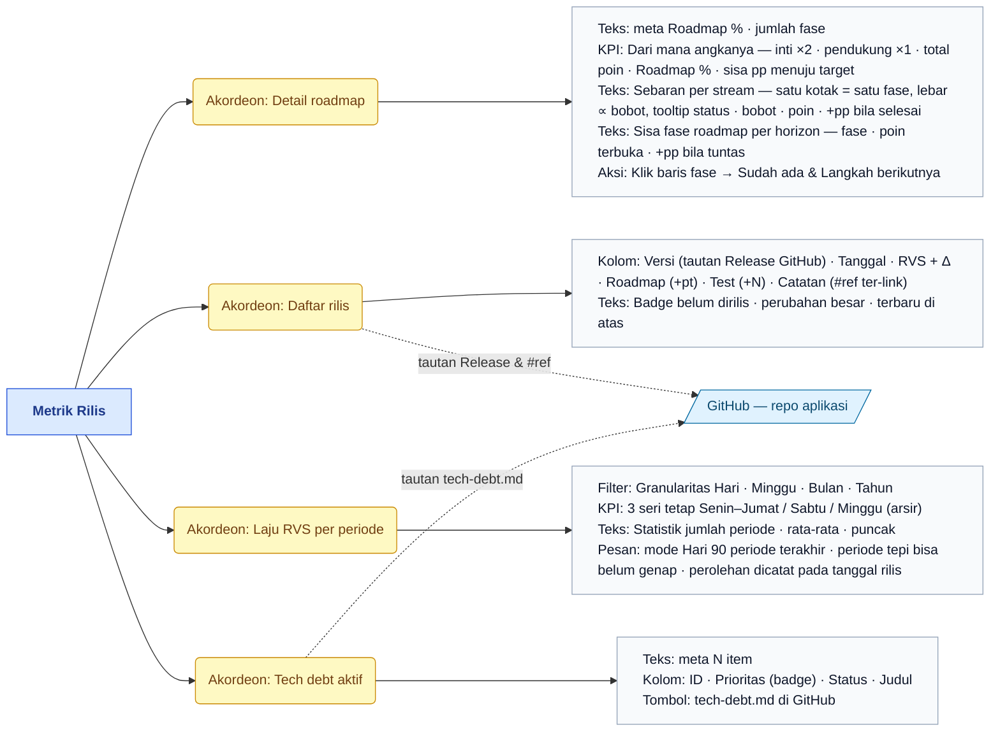
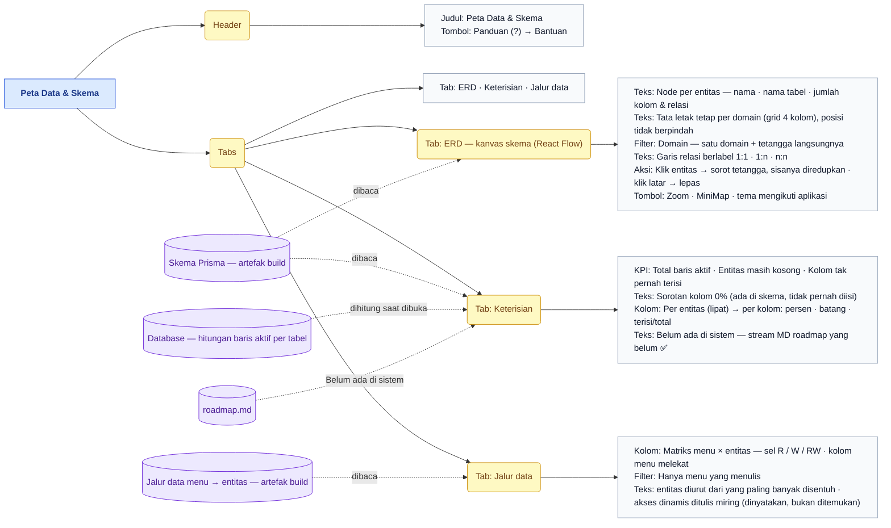
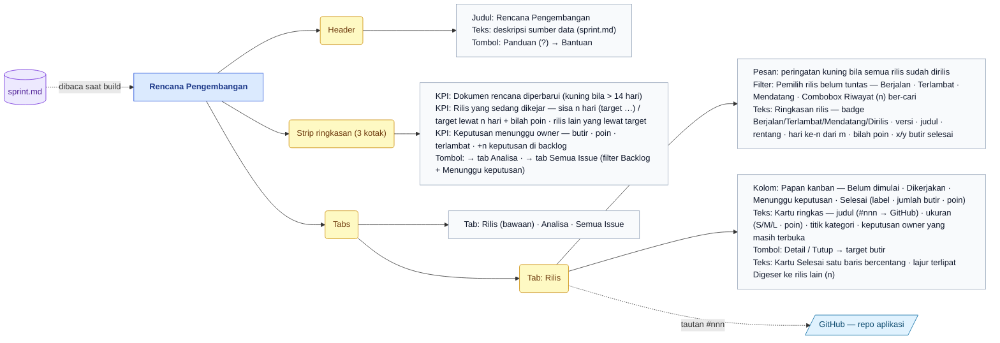
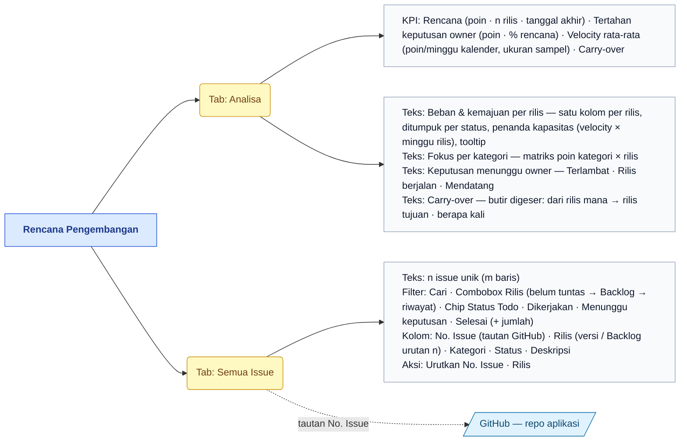
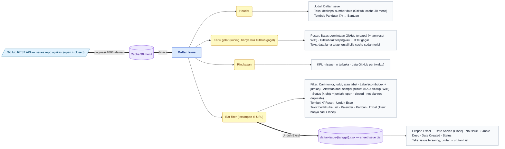
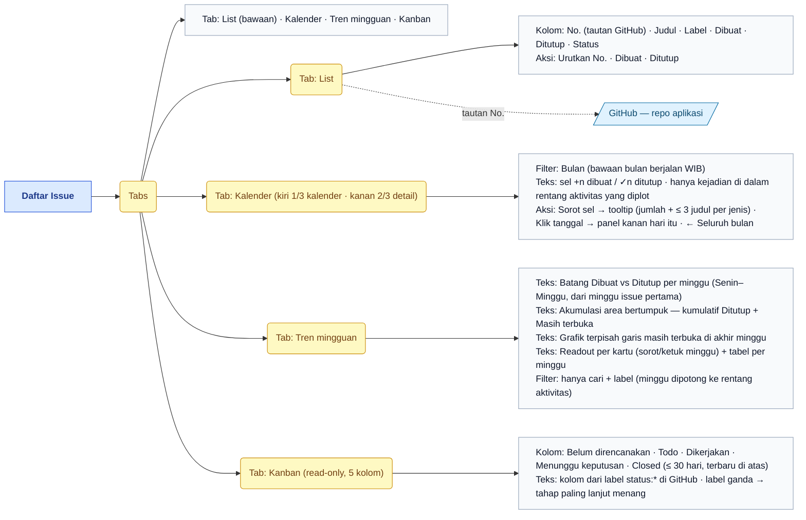
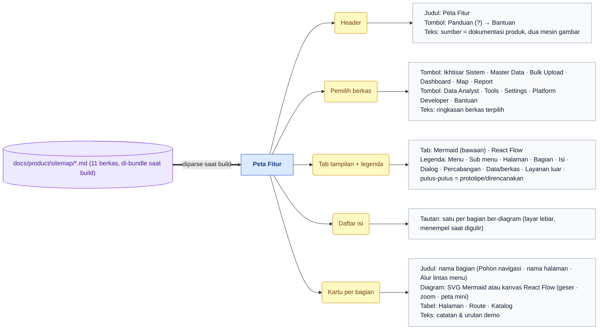
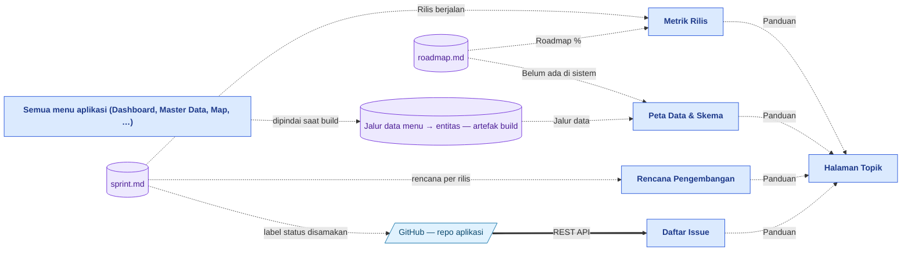

# Peta Fitur — Platform Developer

> Bagian dari dokumentasi **Produk** · Peta fitur untuk Miro. Indeks: [README.md](README.md) · Legenda: [legend.md](legend.md) · Sumber: [../pages/platform-developer/README.md](../pages/platform-developer/README.md)

> **Ringkasan:** Menu tooling internal tim pengembang — tentang aplikasinya sendiri (progres rilis, rencana kerja, struktur data, issue GitHub), bukan tentang data petani. Tiga halaman membaca berkas dokumentasi repo yang di-bundle saat build (`metrics.md`, `roadmap.md`, `tech-debt.md`, `sprint.md`) atau artefak skema; satu halaman membaca GitHub REST API langsung; satu halaman (Peta Fitur) menampilkan berkas peta fitur ini sendiri. Lima sub menu, lima halaman.

## Pohon navigasi

| Halaman | Route | Katalog |
|---|---|---|
| Metrik Rilis | `/admin/dashboard/metrics` | [data-analyst/metrics.md](../pages/data-analyst/metrics.md) |
| Peta Data & Skema | `/admin/data-analyst/data-map` | [data-analyst/data-map.md](../pages/data-analyst/data-map.md) |
| Rencana Pengembangan | `/admin/data-analyst/sprint` | [data-analyst/sprint.md](../pages/data-analyst/sprint.md) |
| Daftar Issue | `/admin/platform-developer/issues` | [platform-developer/issues.md](../pages/platform-developer/issues.md) |
| Peta Fitur | `/admin/platform-developer/sitemap` | [platform-developer/sitemap.md](../pages/platform-developer/sitemap.md) |

Halaman induk `/admin/platform-developer` tidak punya isi; ia mengalihkan ke sub menu pertama yang boleh diakses (bawaan Metrik Rilis). Tiga halaman pertama dipindahkan dari menu Data Analyst pada 2026-10-07 — route dan katalognya sengaja tetap memakai segmen lama agar tautan yang beredar tidak putus.

## Metrik Rilis — bagian 1/2

## Metrik Rilis — bagian 2/2

Empat akordeon di bawah grafik, semuanya tertutup secara bawaan.

## Peta Data & Skema

## Rencana Pengembangan — bagian 1/2

## Rencana Pengembangan — bagian 2/2

## Daftar Issue — bagian 1/2

## Daftar Issue — bagian 2/2

## Peta Fitur

Halaman ini menampilkan berkas-berkas peta fitur ini sendiri — termasuk diagram di atas. Pilihan berkas dan tab tersimpan di URL sehingga bisa dibagikan.

## Alur lintas menu

Menu ini tidak membuka halaman data petani dan tidak dibuka dari menu lain. Hubungannya ke luar lewat **sumber**: `sprint.md` dibaca dua halaman (Rilis berjalan di Metrik Rilis, rencana penuh di Rencana Pengembangan) dan label `status:*` di GitHub disamakan dengannya — sehingga Kanban Daftar Issue (kondisi nyata di GitHub) dan kanban Rencana Pengembangan (rencana) menampilkan tahapan yang sama. Tab Jalur data di Peta Data & Skema memetakan semua menu aplikasi ke entitas yang mereka baca/tulis. Setiap halaman punya tombol Panduan (?) ke tutorial Bantuan (p-8, p-10, p-15, p-19).

## Urutan demo yang disarankan

1. Buka Platform Developer → Metrik Rilis: baca kartu Rilis terakhir (versi, RVS, Roadmap %) dan Rilis berjalan, lalu jalur kesehatan 4 sel.
2. Ganti tab grafik RVS → Roadmap → Test dan rentang waktu; buka akordeon Detail roadmap lewat tombol Progres roadmap, lalu Daftar rilis.
3. Buka Rencana Pengembangan: strip ringkasan, pemilih rilis berjalan, papan kanban 4 kolom; klik Detail pada satu kartu, lalu buka tab Analisa (beban & kapasitas per rilis).
4. Buka Daftar Issue: tunjukkan ringkasan dari GitHub, filter cari/label/status, tab Kalender (sorot sel, klik tanggal) dan Tren mingguan.
5. Tab Kanban Daftar Issue: bandingkan kolomnya dengan kanban Rencana Pengembangan — kondisi nyata GitHub vs rencana. Klik Unduh Excel dan buka berkasnya.
6. Tutup dengan Peta Data & Skema: ERD (saring satu domain, klik entitas), tab Keterisian (kolom 0%), tab Jalur data (saring hanya menu yang menulis).
