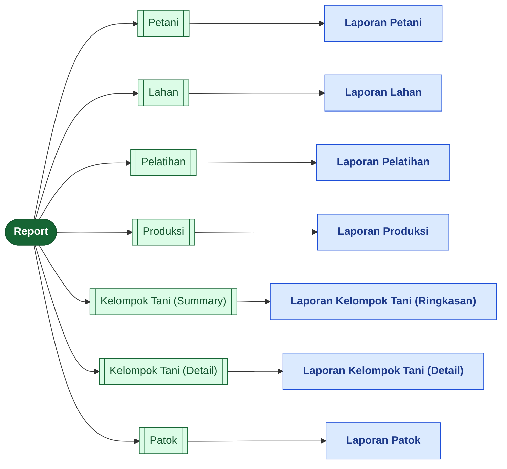
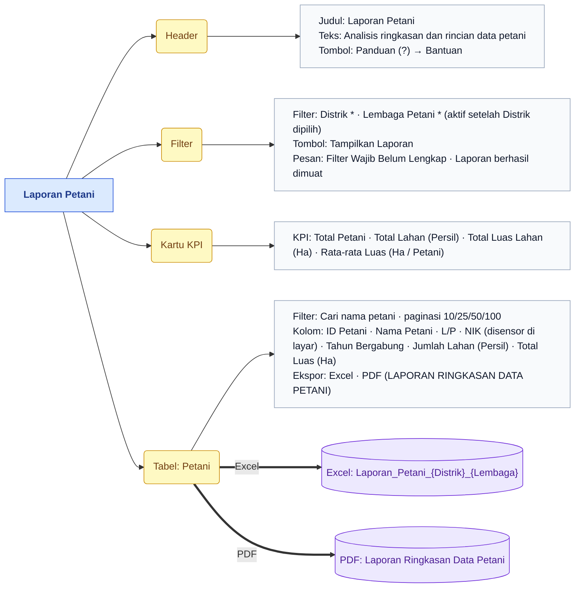
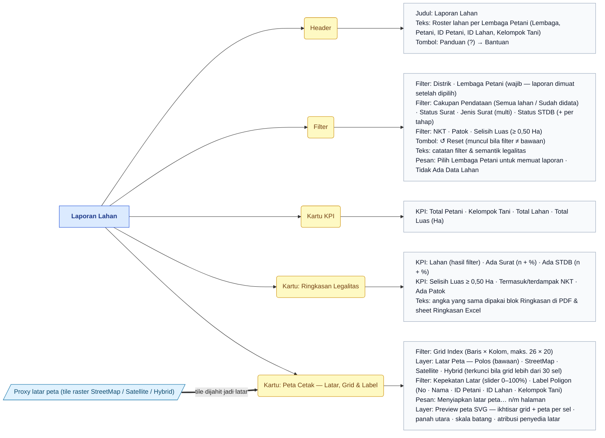
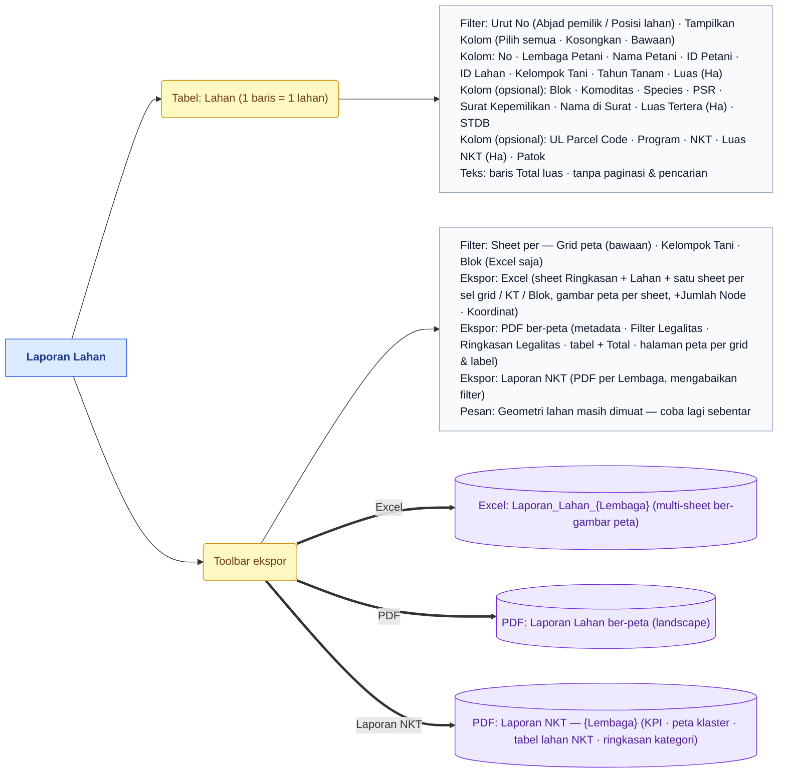
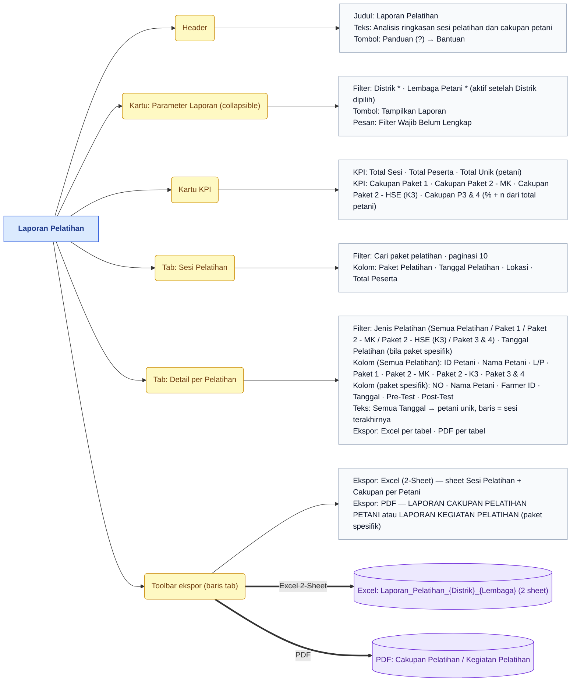
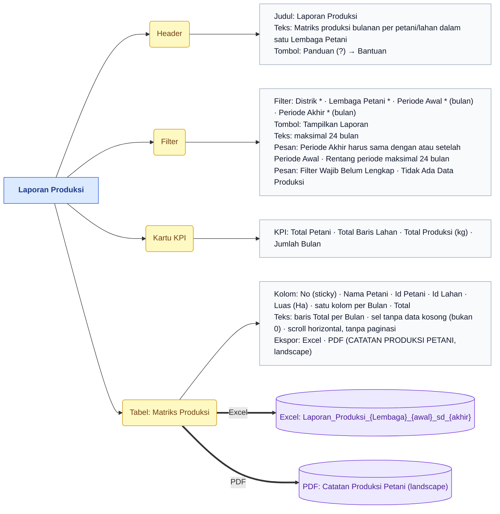
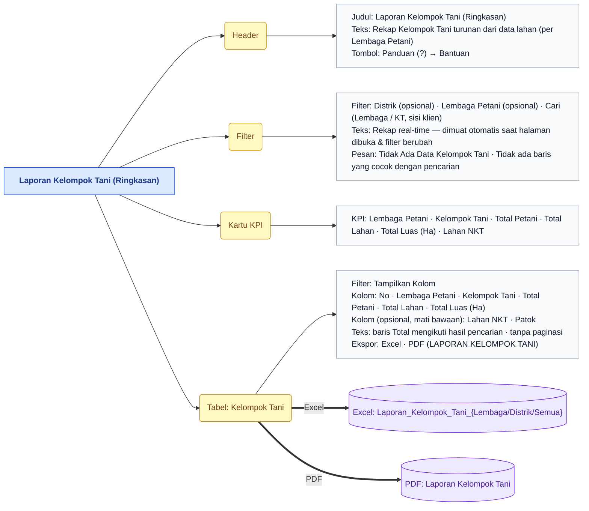
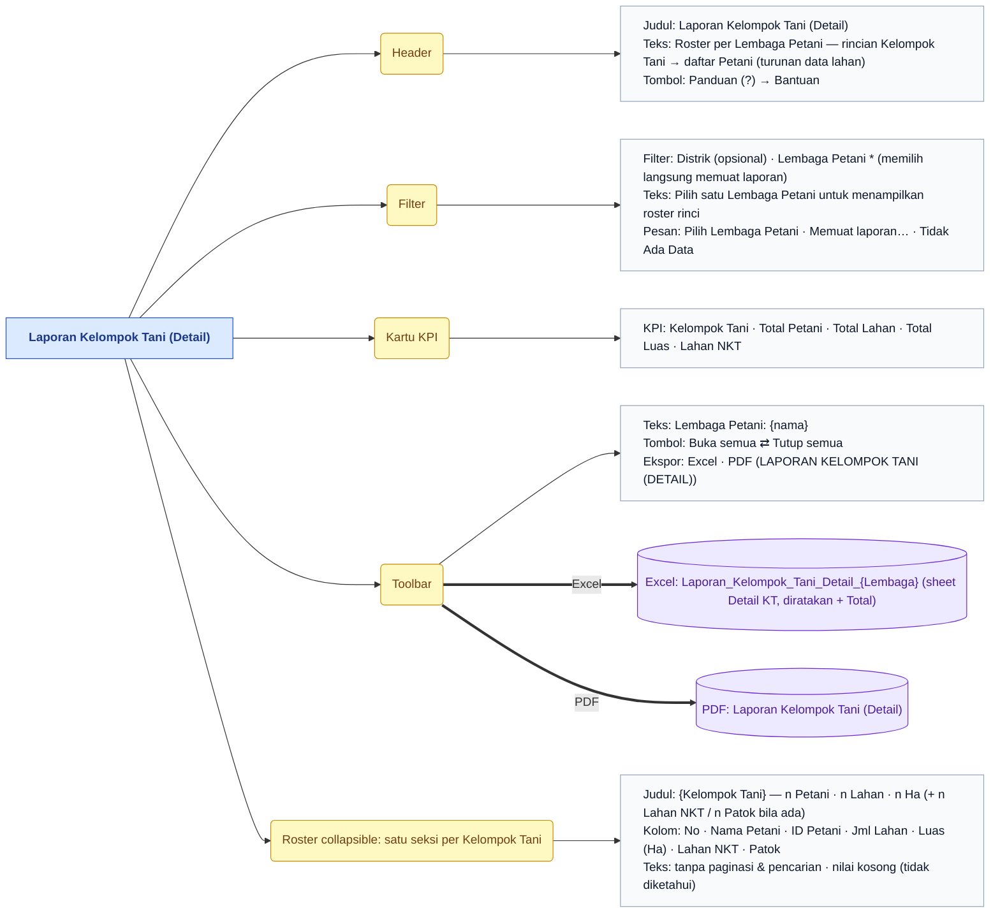
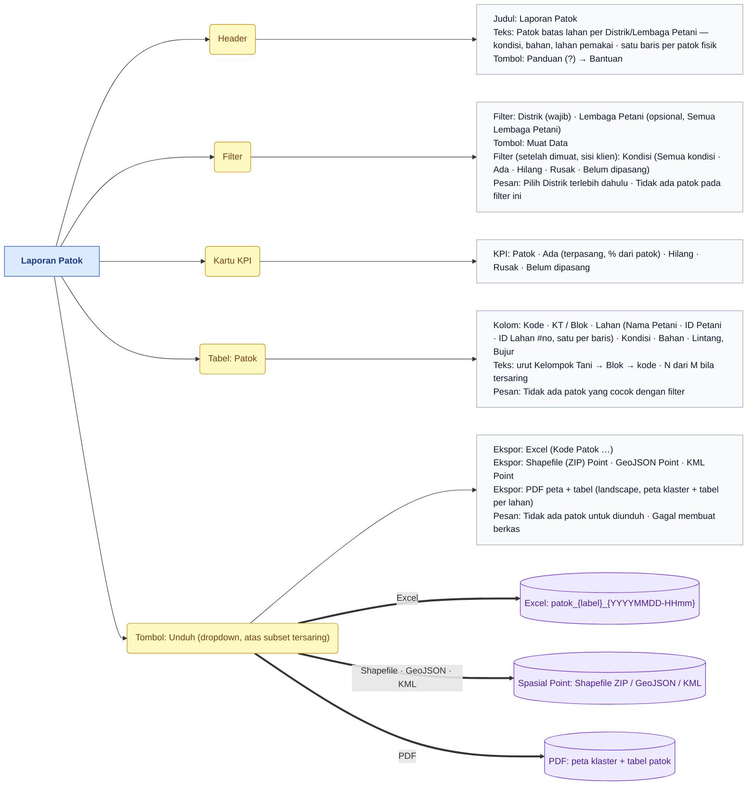
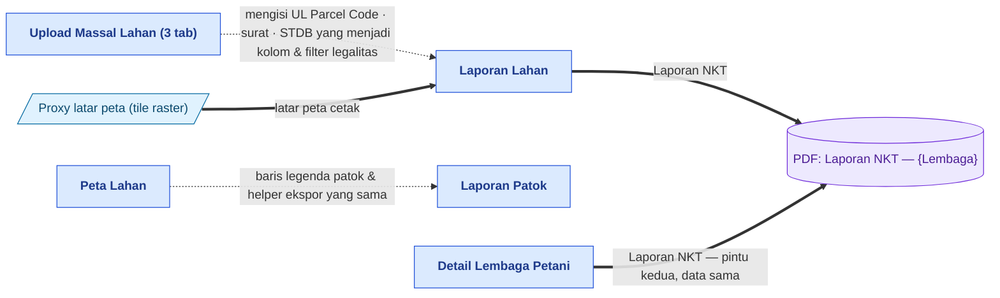

# Peta Fitur — Report

> Bagian dari dokumentasi **Produk** · Peta fitur untuk Miro. Indeks: [README.md](README.md) · Legenda: [legend.md](legend.md) · Sumber: [../pages/report/README.md](../pages/report/README.md)

> **Ringkasan:** Menu laporan siap cetak: pengguna memilih Distrik → Lembaga Petani (kadang periode), lalu mendapat kartu KPI, tabel pratinjau, dan berkas Excel/PDF — Laporan Lahan juga mencetak peta poligon ber-latar, Laporan Patok menghasilkan berkas spasial. Tujuh sub menu, tujuh halaman (satu halaman per sub menu, tanpa halaman detail).

## Pohon navigasi

| Halaman | Route | Katalog |
|---|---|---|
| Laporan Petani | `/admin/report/farmer` | [farmer.md](../pages/report/farmer.md) |
| Laporan Lahan | `/admin/report/land-parcel` | [land-parcel.md](../pages/report/land-parcel.md) |
| Laporan Pelatihan | `/admin/report/training` | [training.md](../pages/report/training.md) |
| Laporan Produksi | `/admin/report/production` | [production.md](../pages/report/production.md) |
| Laporan Kelompok Tani (Ringkasan) | `/admin/report/kelompok-tani` | [kelompok-tani.md](../pages/report/kelompok-tani.md) |
| Laporan Kelompok Tani (Detail) | `/admin/report/kelompok-tani-detail` | [kelompok-tani-detail.md](../pages/report/kelompok-tani-detail.md) |
| Laporan Patok | `/admin/report/marker` | [marker.md](../pages/report/marker.md) |

Halaman induk `/admin/report` tidak punya isi; ia mengalihkan ke sub menu pertama (urut `order`) yang boleh diakses pengguna.

## Laporan Petani

## Laporan Lahan — bagian 1/2 (filter, KPI, peta cetak)

## Laporan Lahan — bagian 2/2 (tabel, ekspor, Laporan NKT)

## Laporan Pelatihan

## Laporan Produksi

## Laporan Kelompok Tani (Ringkasan)

## Laporan Kelompok Tani (Detail)

## Laporan Patok

## Alur lintas menu

Semua laporan membaca data **real-time** dari Master Data (petani, lahan, pelatihan, produksi) — berbeda dengan Dashboard yang membaca snapshot (lihat [tools.md](tools.md)). Laporan NKT yang sama bisa dicetak dari Laporan Lahan maupun dari Detail Lembaga Petani di Master Data; keduanya memuat seluruh lahan aktif Lembaga, tidak mengikuti filter. Filter "Cakupan Pendataan: Sudah didata" di Laporan Lahan bergantung pada UL Parcel Code yang masuk lewat Bulk Upload Detail Lahan.

## Urutan demo yang disarankan

1. Buka Report → Petani: pilih Distrik, lalu Lembaga Petani, klik Tampilkan Laporan — tunjukkan pola yang sama berlaku di semua laporan (KPI → tabel → Excel/PDF).
2. Report → Pelatihan: buka tab Detail per Pelatihan, ganti Jenis Pelatihan dari Semua Pelatihan ke satu paket, tunjukkan tabel peserta dan bentuk PDF yang berubah.
3. Report → Produksi: isi Periode Awal/Akhir (≤ 24 bulan), tunjukkan matriks bulanan dan PDF landscape.
4. Report → Kelompok Tani (Summary) lalu (Detail): rekap otomatis tanpa tombol, selektor kolom Lahan NKT & Patok, roster collapsible Buka semua.
5. Report → Lahan: pilih Lembaga, mainkan filter legalitas dan tombol ↺ Reset, lihat kartu Ringkasan Legalitas ikut berubah.
6. Masih di Lahan: atur Grid Index, ganti Latar Peta ke Hybrid dan kepekatan, tunggu indikator latar, lalu unduh PDF ber-peta dan Excel multi-sheet (Sheet per Kelompok Tani).
7. Klik Laporan NKT dan tunjukkan bahwa PDF-nya tidak mengikuti filter.
8. Report → Patok: Muat Data, saring Kondisi, unduh Shapefile/GeoJSON/KML dan PDF peta + tabel.
