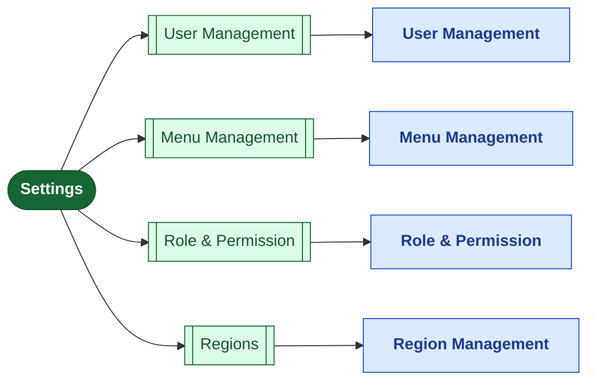
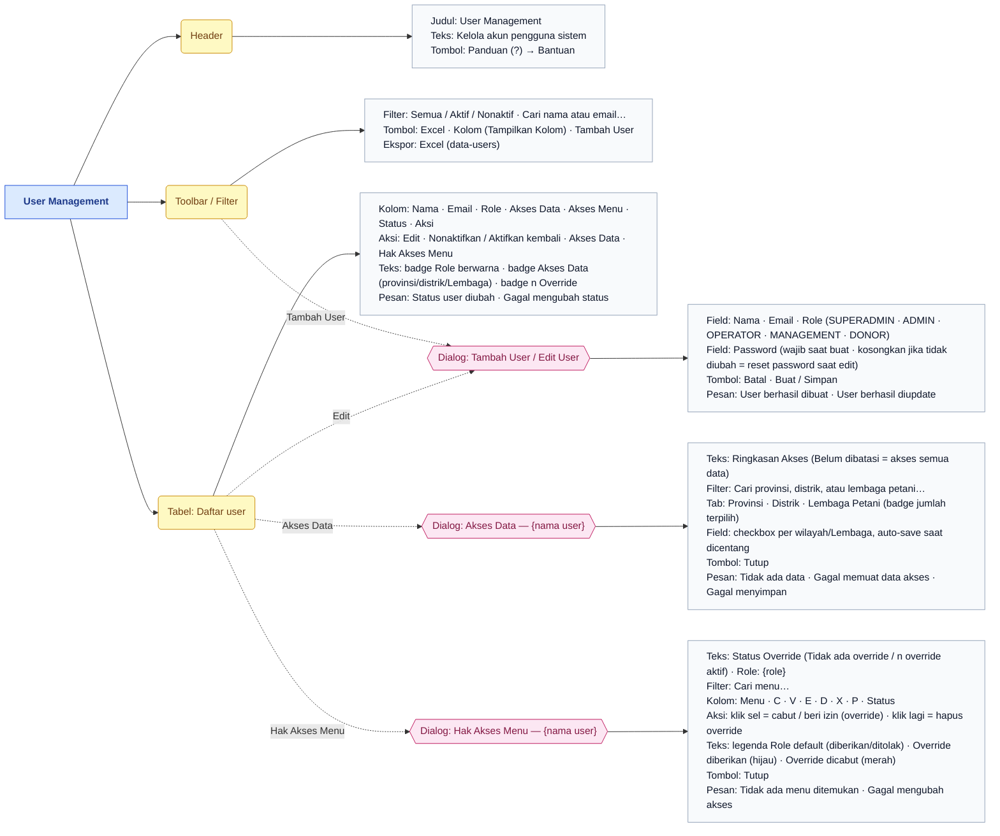
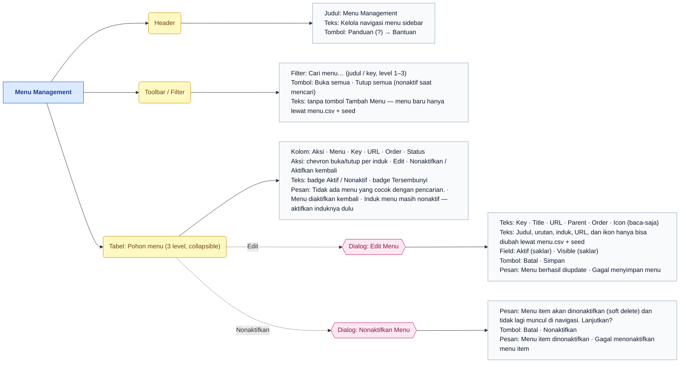
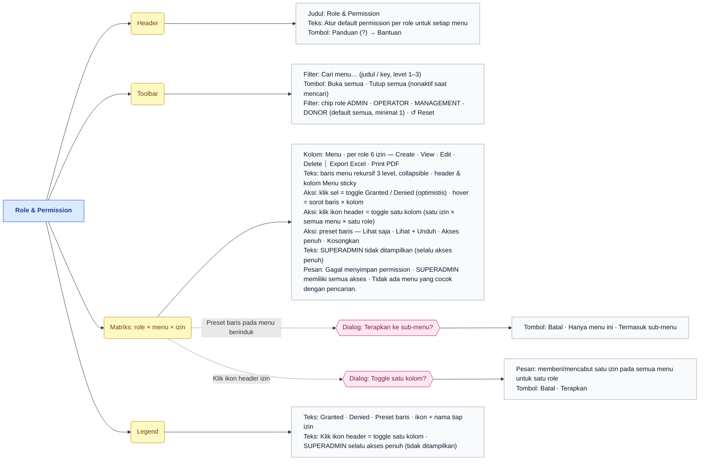
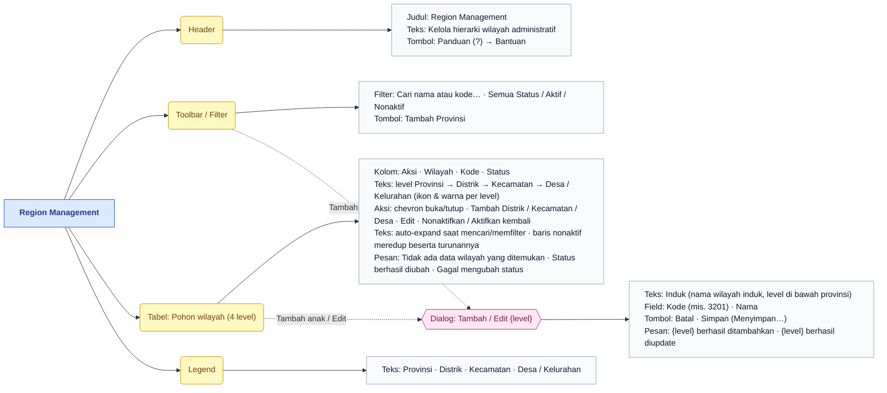
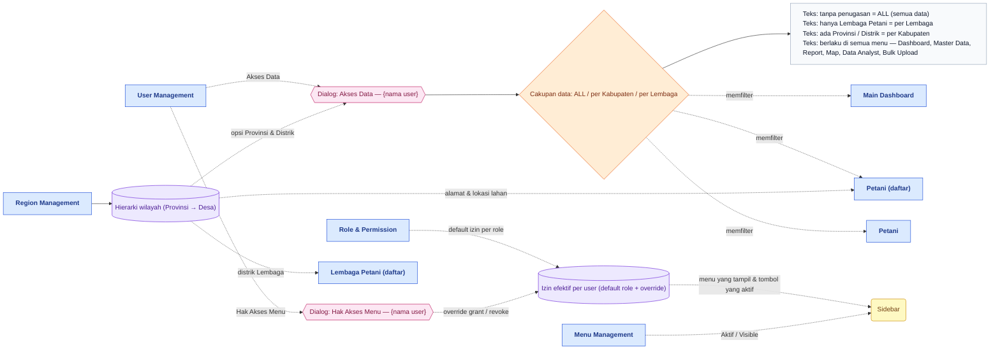

# Peta Fitur — Settings

> Bagian dari dokumentasi **Produk** · Peta fitur untuk Miro. Indeks: [README.md](README.md) · Legenda: [legend.md](legend.md) · Sumber: [../pages/settings/README.md](../pages/settings/README.md)

> **Ringkasan:** Menu administrasi platform (khusus SUPERADMIN): siapa yang boleh masuk (**User Management**), menu apa yang tampil di sidebar (**Menu Management**), aksi apa yang boleh dilakukan tiap role (**Role & Permission**), dan hierarki wilayah yang dipakai seluruh data (**Regions**). Empat sub menu, empat halaman — semuanya satu halaman tabel/matriks dengan dialog, tanpa halaman detail.

## Pohon navigasi

| Halaman | Route | Katalog |
|---|---|---|
| User Management | `/admin/settings/users` | [users.md](../pages/settings/users.md) |
| Menu Management | `/admin/settings/menu` | [menu.md](../pages/settings/menu.md) |
| Role & Permission | `/admin/settings/roles` | [roles.md](../pages/settings/roles.md) |
| Region Management | `/admin/settings/regions` | [regions.md](../pages/settings/regions.md) |

Halaman induk `/admin/settings` tidak punya isi; ia mengalihkan ke sub menu pertama yang boleh diakses.

## User Management

Dialog **Akses Data** menyimpan penugasan Provinsi / Distrik / Lembaga Petani yang menjadi cakupan data user di **semua** menu (lihat [Alur lintas menu](#alur-lintas-menu)). Dialog **Hak Akses Menu** hanya tampil untuk akun non-SUPERADMIN dan bukan akun sendiri; menu level 3 (Fire Alert) tidak muncul di matriks override.

## Menu Management

Sejak #364 halaman ini hanya mengubah **Aktif** dan **Visible**; struktur menu (judul, urutan, induk, URL, ikon) dan menu baru datang dari `prisma/seeds/data/menu.csv` + seed. **Aktifkan kembali** pada baris nonaktif berjalan langsung tanpa dialog.

## Role & Permission

Matriks berisi **4 role yang bisa diubah** (ADMIN, OPERATOR, MANAGEMENT, DONOR) × seluruh menu × 6 izin (VIEW/CREATE/EDIT/DELETE/EXPORT/PRINT). Perubahan tersimpan langsung saat sel diklik (optimistis, revert bila gagal); izin induk mengaskade ke anak lewat dialog kaskade.

## Region Management

Satu dialog yang sama dipakai untuk keempat level; judulnya mengikuti level (`Tambah Provinsi`, `Edit Distrik`, `Tambah Kecamatan`, `Tambah Desa / Kelurahan`). Level Desa / Kelurahan tidak punya aksi **Tambah** anak.

## Alur lintas menu

- **Penugasan user → cakupan data.** Centang Provinsi/Distrik/Lembaga di dialog Akses Data menentukan data mana yang terlihat user di **semua** menu: tanpa penugasan = ALL; hanya Lembaga Petani = per Lembaga; ada Provinsi/Distrik = per Kabupaten (Provinsi diurai menjadi semua distriknya). SUPERADMIN selalu ALL.
- **Role & Permission + override → sidebar dan tombol.** Izin default per role (matriks) digabung dengan override per user (Hak Akses Menu) menjadi izin efektif; menu tanpa VIEW hilang dari sidebar, tombol Tambah/Edit/Nonaktifkan/Excel/PDF mengikuti CREATE/EDIT/DELETE/EXPORT/PRINT.
- **Menu Management → sidebar.** Saklar Aktif dan Visible menentukan menu mana yang dirender di sidebar untuk semua user; struktur menunya sendiri berasal dari `menu.csv`.
- **Regions → semua data berwilayah.** Provinsi/Distrik yang dibuat di sini menjadi pilihan di Akses Data, alamat Petani, lokasi Lahan, distrik Lembaga Petani, dan filter wilayah di Dashboard/Report/Map.

## Urutan demo yang disarankan

1. Buka Settings → Regions: tunjukkan pohon Provinsi → Distrik → Kecamatan → Desa, cari satu kode, tambah satu Distrik lewat dialog.
2. Buka Role & Permission: pilih chip role OPERATOR saja, buka satu menu, klik sel untuk mengubah izin, lalu coba preset baris `Lihat + Unduh` → dialog kaskade `Termasuk sub-menu`.
3. Buka User Management → Tambah User (role OPERATOR), lalu Edit untuk menunjukkan reset password (`kosongkan jika tidak diubah`).
4. Pada user yang sama klik Akses Data: centang satu Lembaga Petani → Ringkasan Akses berubah; jelaskan bahwa cakupan data user kini per Lembaga di semua menu.
5. Klik Hak Akses Menu: cabut satu izin (sel merah) dan beri satu izin tambahan (sel hijau); badge `n Override` muncul di tabel.
6. Masuk sebagai user tersebut (tab lain): sidebar dan tombol mengikuti izin efektif, data terbatas pada Lembaga yang ditugaskan.
7. Kembali sebagai SUPERADMIN → Menu Management: matikan saklar Visible satu menu → menu hilang dari sidebar; nyalakan kembali.
