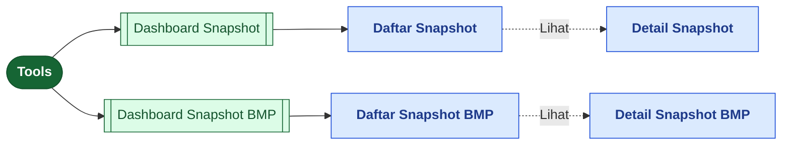
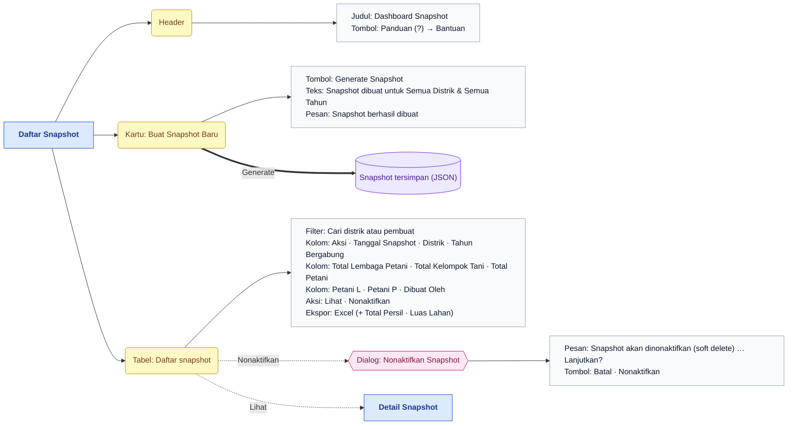
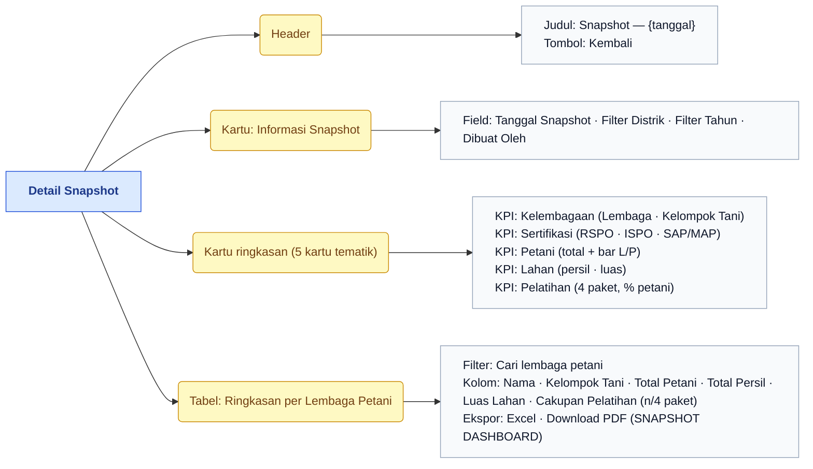
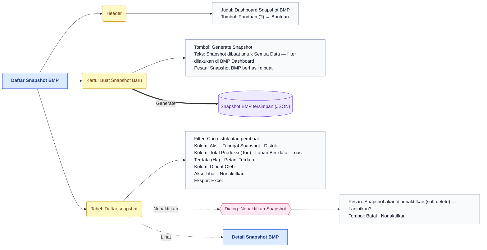
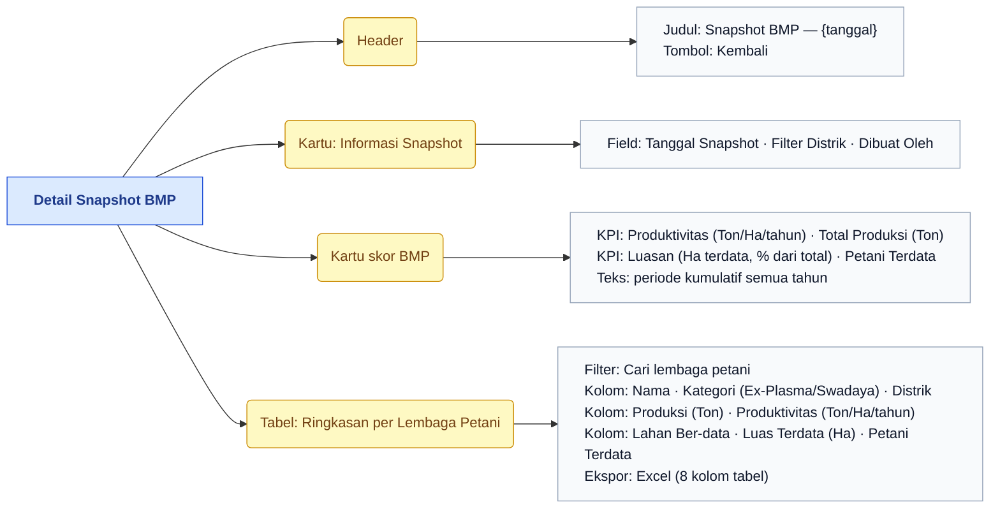
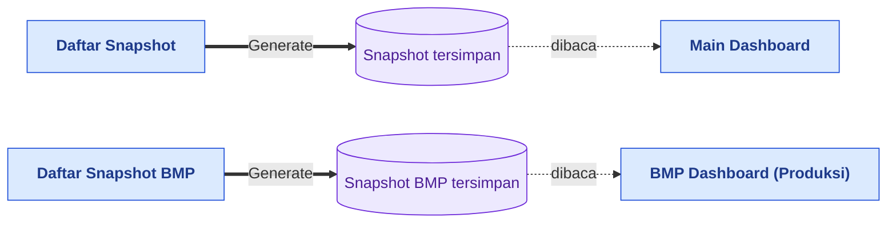

# Peta Fitur — Tools

> Bagian dari dokumentasi **Produk** · Peta fitur untuk Miro. Indeks: [README.md](README.md) · Legenda: [legend.md](legend.md) · Sumber: [../pages/tools/README.md](../pages/tools/README.md)

> **Ringkasan:** Menu perawatan angka dashboard: membekukan data menjadi **snapshot** historis agar Main Dashboard dan BMP Dashboard membaca angka yang sudah dihitung, bukan query langsung. Dua sub menu, empat halaman.

## Pohon navigasi

| Halaman | Route | Katalog |
|---|---|---|
| Daftar Snapshot | `/admin/tools/snapshot` | [snapshot/list.md](../pages/tools/snapshot/list.md) |
| Detail Snapshot | `/admin/tools/snapshot/{id}` | [snapshot/detail.md](../pages/tools/snapshot/detail.md) |
| Daftar Snapshot BMP | `/admin/tools/snapshot-bmp` | [snapshot-bmp/list.md](../pages/tools/snapshot-bmp/list.md) |
| Detail Snapshot BMP | `/admin/tools/snapshot-bmp/{id}` | [snapshot-bmp/detail.md](../pages/tools/snapshot-bmp/detail.md) |

Halaman induk `/admin/tools` tidak punya isi; ia mengalihkan ke sub menu pertama yang boleh diakses.

## Daftar Snapshot

## Detail Snapshot

## Daftar Snapshot BMP

## Detail Snapshot BMP

## Alur lintas menu

Main Dashboard dan BMP Dashboard menampilkan snapshot **terbaru**; angka berubah hanya setelah snapshot baru dibuat (lihat [dashboard.md](dashboard.md)).

## Urutan demo yang disarankan

1. Buka Tools → Dashboard Snapshot, tunjukkan daftar dan tanggal snapshot terakhir.
2. Klik Generate Snapshot, tunggu toast, baris baru muncul di atas.
3. Buka Lihat → Detail Snapshot: kartu ringkasan, tabel per Lembaga, Download PDF.
4. Kembali ke Main Dashboard: angka kini mengikuti snapshot baru.
5. Ulangi pola yang sama untuk Snapshot BMP → BMP Dashboard.
